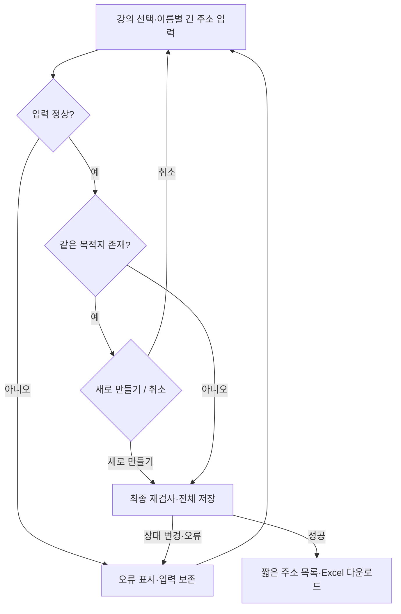
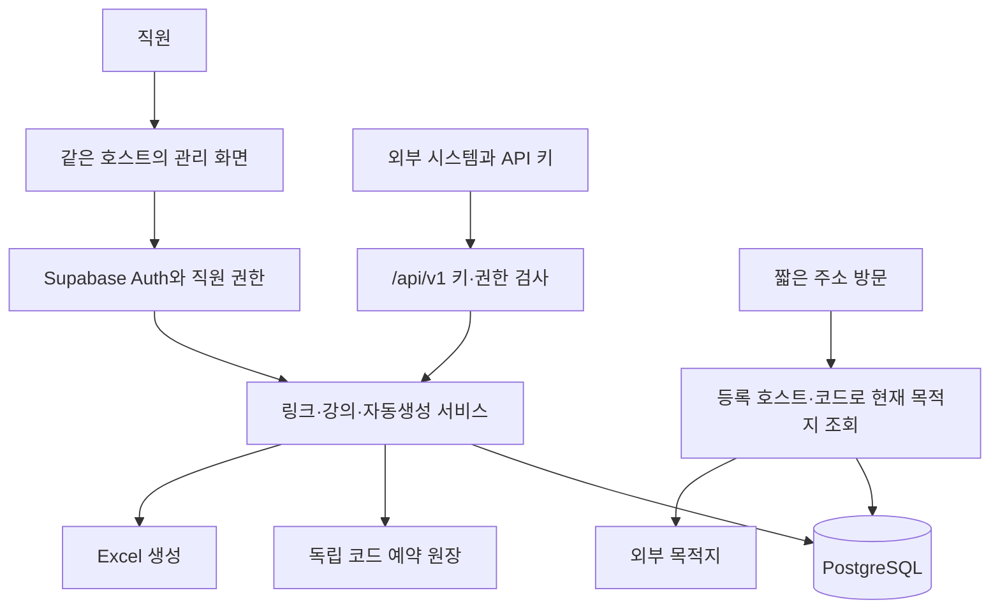

# BZUP Link — 짧은 주소·강의별 링크 관리 서비스 PRD

- 문서 버전: **2.2**
- 작성·개정일: **2026-11-18, Asia/Seoul**
- 문서 상태: 개발 착수용 통합 제품 요구사항 및 기술 설계안
- 서비스명: BZUP Link / 비즈업 링크 — 가칭
- 초기 접속 주소: **Vercel 프로젝트의 고정 Production 주소 — 실제 배포 후 확정**
- 사용자 지정 도메인: **bzup.io 등 보유하거나 나중에 구입한 도메인을 후속 연결**
- 운영 범위: 한 조직의 내부 직원용 서비스. 도메인 연결 전에도 전체 기능 검수 가능
- 로그인 인증: **Supabase Auth — 사용자 지정 사항**
- 산출물 범위: 화면, 권한, 데이터 모델, API, 처리 규칙, 운영, 인수 기준
- 적용 관계: 이 문서가 기존 PRD 1.0·2.0·2.1을 대체한다. 개발·배포가 완료되었다는 의미는 아니다.
- 용어 정정: 사용자가 말한 “QR”은 **짧은 주소**를 뜻한다. 모든 화면과 기능명을 짧은 주소로 통일하며, 실제 QR 코드 이미지 생성·다운로드는 범위에 포함하지 않는다.

> **제품 정의**
>
> 직원이 강의를 선택하고 명칭·긴 주소를 입력하면 고정된 짧은 URL을 만든다. 최초 주소·현재 목적지·변경 이력을 저장하고, 목적지가 바뀌어도 짧은 URL을 유지한다. 최고관리자는 직원, 강의, 자동생성 이름 목록, API 연동과 API 키의 발급·중지·교체·삭제를 관리한다. 외부 업무 API는 모든 요청에 유효한 BZUP API 키를 요구한다. 직원은 이름 목록을 이용해 여러 링크를 한 번에 생성하고, 필터링한 목록을 Excel로 내려받을 수 있다.
>
> 본문의 이름·URL·UUID·시각은 설명용 예시다. 실제 발급 주소나 현재 직원·강의 현황을 뜻하지 않는다.

---

## 1. 개정 요약과 사용자 요구사항

### 1.1 기존 요구사항 통합 — 1.0에서 2.0

| 영역 | 1.0 | 2.0 |
|---|---|---|
| 인증 | Supabase Auth 권장 | Supabase Auth 사용 확정 |
| 최고 권한 | 관리자 | 최고관리자 owner로 명확화 |
| 직원 관리 | 기본 초대·역할 관리 | 로그인 가능한 직원과 불가 사유를 보여주는 전용 페이지 |
| 강의 분류 | 없음 | 최고관리자 강의 등록, 신규 생성 시 강의 지정, 강의별 필터 |
| 같은 목적지 재생성 | 별도 요청이면 바로 신규 생성 | 중복 알림 후 **새로 만들기 / 취소** |
| 자동생성 | 후속 일괄 기능 | 최고관리자가 저장한 이름 목록에 URL을 입력해 일괄 생성 |
| Excel | 후속 기능 | 필터 전체 결과·선택 행의 실제 XLSX 다운로드 필수 |
| API | 생성·조회·수정 중심 | 강의, 중복 확인, 이름 목록, 일괄 생성, Excel 계약 추가 |
| 기존 링크 안정성 | 코드 고정·중복 코드 차단 | 동일 유지, 강의 분류 추가가 기존 코드나 목적지를 변경하지 않음 |

### 1.2 사용자 요구 추적

| ID | 요구사항 | 주요 설계 위치 |
|---|---|---|
| U-01 | 명칭과 긴 주소로 짧은 주소 생성 | 5, 13, 14절 |
| U-02 | 변환 내역 저장·검색·조회 | 9, 11, 15절 |
| U-03 | 짧은 주소를 유지한 목적지 변경 | 11~12, 16절 |
| U-04 | 외부 API에서 이름·긴 주소를 보내 결과 수신 | 13, 14, 16절 |
| U-05 | Supabase 인증과 최고관리자 직원 조회 | 3, 18절 |
| U-06 | 같은 목적지로 짧은 주소 신규 생성 시 중복 확인 | 6, 14, 16절 |
| U-07 | 최고관리자 강의 등록, 생성 시 선택, 필터 | 4, 5, 8, 9절 |
| U-08 | 자동생성할 이름 목록 저장 및 버튼·팝업 일괄 생성 | 7, 8, 14절 |
| U-09 | 생성 목록을 Excel 형태로 다운로드 | 10절 |
| U-10 | Vercel 기본 주소로 먼저 검수하고 사용자 지정 도메인을 연결해 동일 기능 유지 | 5, 13~16, 18, 20, 22절 |
| U-11 | 외부 API 키 필수, 최고관리자의 발급·조회·권한·만료·교체·삭제 정책 | 3, 13~19, 21~24절 |

### 1.3 반드시 유지할 제품 원칙

1. 이름은 관리용이고, 링크의 고유 식별자는 서버가 발급한 id다.
2. 링크 ID·짧은 코드·최초 발급 주소·최초 목적지는 생성 후 고정한다. 기본 도메인을 바꾸면 현재 공유용 short_url은 새 도메인으로 표시할 수 있지만, 이전 발급 주소도 같은 링크로 계속 연결한다.
3. 같은 목적지를 여러 링크로 만들 수 있지만 신규 생성 전에 확인을 받는다.
4. 중복 확인은 같은 회사 전체에서 수행한다. 강의가 다르다고 생략하지 않는다.
5. 생성·수정은 이력과 함께 저장한다.
6. 일괄 생성은 입력 행 전체의 링크·이력을 모두 저장하거나 모두 취소한다.
7. 최고관리자 권한은 서버가 확인하는 회사 멤버십에서 결정한다.
8. 공개 방문자에게 로그인이나 직원 권한을 요구하지 않는다.
9. 화면·API·Excel은 같은 회사 범위와 필터 규칙을 사용한다.
10. 도메인 연결은 주소 설정의 전환이다. 직원·강의·링크·이력·API 키·짧은 코드를 재발급하거나 DB를 교체하지 않는다.
11. 외부 API 키는 연동 프로그램의 자격증명이다. 직원 로그인·최고관리자 권한을 대체하지 않으며, 공개 짧은 주소를 클릭할 때는 필요하지 않다.
12. 키 삭제는 영구 폐기다. 해당 키로 만든 짧은 주소와 변경 이력은 보존한다.

### 1.4 이전 개정 — 2.1의 배포·도메인 정책

- Vercel 기본 Production 주소에서 먼저 로그인·생성·수정·자동생성·API·Excel을 검수한다.
- 사용자 지정 도메인은 나중에 같은 프로젝트의 같은 운영 환경에 추가한다.
- 초기에는 한 호스트에서 관리 화면, 외부 API, 공개 이동을 경로로 구분한다. 관리·API 전용 하위 도메인을 먼저 준비할 필요가 없다.
- 기존 발급 주소와 새 도메인의 같은 코드가 같은 링크 ID를 가리키게 한다.
- 최초 발급 주소와 현재 공유용 주소를 분리하고, 도메인 전환 시 로그인·기존 이메일 링크·API 재시도·Excel 일관성을 검수한다.

### 1.5 이번 개정 — 2.2의 API 키 정책

- 외부 `/api/v1/**`의 생성·조회·수정·중복 검토·자동생성·Excel 요청에 BZUP API 키를 필수로 한다.
- 최고관리자 전용 API 키 페이지, 발급·메타데이터 조회·권한 축소·만료 단축·일시중지·재개·교체·삭제를 P0로 정의한다.
- 키 원문은 발급 응답에서 한 번만 제공하며, DB에는 검증용 해시만 저장한다.
- 기본 만료 90일, 선택 범위 1~365일, 교체 시 기본 24시간 병행 사용을 초기 제품 정책으로 정한다.
- 삭제는 즉시 영구 폐기하며 링크·이력·감사 기록을 남긴다. 직원 퇴사, 연동 중지, 도메인 변경과 키의 관계도 명시한다.
- 키 발급 재시도는 원문 없는 메타데이터만 돌려준다. 일반 링크 API의 최초 성공 응답 재생과 구분한다.

---

## 2. 범위와 확정 기본값

### 2.1 출시 필수 — P0

- Supabase Auth 로그인, 초대 수락·초기 설정·비밀번호 재설정.
- 최고관리자 직원 목록, 로그인 가능 상태, 초대·역할·접근 중지 관리.
- 진행중 강의 등록·수정·종료와 기존 링크 재분류.
- 단건 짧은 주소 생성, 중복 확인, 복사.
- 링크 목록·검색·필터·상세·변경 이력.
- 목적지·명칭·강의·활성 상태 수정.
- 자동생성 이름 목록 관리 및 모든 이름 행의 일괄 생성.
- 현재 조건 전체 또는 선택 행의 XLSX 다운로드.
- 외부 API 키 필수 인증, 연동별 키 발급·조회·권한·만료·중지·재개·교체·삭제, 중복 요청·동시 수정 방지.
- 코드 예약·충돌 재시도, 백업·복구, 기본 운영 모니터링.
- Vercel 기본 주소 우선 배포와 사용자 지정 도메인 후속 연결. 도메인 전환 전후 기능·기존 주소 호환성 검수.

### 2.2 후속 — P1

클릭·방문자 통계, 사용자 지정 짧은 코드, CSV 가져오기, 이름 목록 여러 개 운영, 예약 목적지 변경, 원클릭 과거 목적지 복원, 웹훅은 후속 범위다.

### 2.3 V2.2 기본값

Supabase Auth, Vercel 기본 주소에서 우선 검수, 나중에 사용자 지정 도메인 연결은 사용자 지정 사항이다. bzup.io는 연결할 도메인의 예시이며 초기 배포의 선행 조건이 아니다. 역할 구분, 회사당 이름 목록 1개, 강의 필수 선택, 처리 한도와 권장 기술은 이 PRD에서 정한 초기 운영 기준이다. 외부 API 키 필수는 사용자 지정 사항이며, 90일 만료·교체 유예·키 수 등 구체적인 기간과 한도는 구현 가능한 기본값을 정한 제품 정책이다.

아래 {origin}은 DB에서 관리하는 현재 기본 HTTPS 주소다. 처음에는 Vercel에서 실제 부여한 고정 Production 주소이고, 전환 후에는 https://bzup.io 같은 연결 완료 도메인이다. 문서의 bzup-link-demo.vercel.app은 설명용이며 실제 확보·배포된 주소가 아니다.

| 항목 | 결정 |
|---|---|
| 운영 범위 | 한 조직의 내부 관리 서비스 |
| 관리 화면 | {origin}/links, {origin}/admin/... |
| 외부 API | {origin}/api/v1 |
| 공개 링크 | {origin}/{short_code}; 이전 등록 도메인에서도 같은 코드로 접속 가능 |
| 초기 호스트 | 프로젝트의 고정 Production .vercel.app 주소 |
| 후속 도메인 | 같은 프로젝트에 사용자 지정 도메인 추가, 기존 주소 유지 |
| 코드 | 대·소문자·숫자 Base62 7자리 |
| 로그인 | 초대 기반 이메일·비밀번호, Supabase Auth |
| 외부 API 인증 | HTTPS + Authorization: Bearer {BZUP_API_KEY}, 모든 업무 요청 필수 |
| 키 관리 | 활성 owner만 발급·조회·중지·교체·삭제 |
| 신규 키 기본 권한 | links:create만 선택, 추가 권한은 명시 선택 |
| 키 유효기간 | 기본 90일, 1~365일; 무기한 발급 없음 |
| 교체 병행 기간 | 기본 24시간, 즉시 또는 1~168시간 선택 |
| 연동별 보유 키 | 유효기간·폐기 예정 시각이 남은 활성/중지 키 합계 최대 5개 |
| 키 삭제 | 복구 불가한 영구 폐기, 기존 링크·감사 기록 유지 |
| 역할 | owner / editor / viewer |
| 신규 링크의 강의 | 진행중 강의 1개 필수 |
| 기존 미분류 링크 | course_id=null 유지 가능, 화면에서 미분류 |
| 강의 상태 | active=진행중, closed=종료 |
| 링크 상태 | active=활성, inactive=비활성 |
| 자동생성 목록 | 회사당 재사용 이름 목록 1개 |
| 자동생성 행 수 | 저장 시 활성 이름 0~100개, 실행 시 1~100개 전체 생성 |
| 일괄 실행 | 동기 요청, 저장 성공 후 전체 결과 반환 |
| Excel | 실제 .xlsx, 현재 필터 전체 또는 선택 ID |
| 시각 | DB/API UTC, 화면·Excel 한국 시간 |
| 영구 삭제 | 링크·강의·직원에 일반 삭제 UI를 제공하지 않음 |

단건 생성과 외부 API의 기본 사용성을 유지하되 최종 저장값에는 강의가 있어야 한다. API에서 course_id를 생략하려면 최고관리자가 해당 API 연동에 기본 강의를 지정해야 한다.

---

## 3. Supabase 인증과 최고관리자·직원 관리

### 3.1 인증과 권한 분리

- **Supabase Auth:** 계정, 이메일 확인, 비밀번호, 로그인 세션.
- 웹 인증은 서버가 세션 발급·갱신을 담당하는 BFF 방식으로 구성한다. 브라우저는 같은 출처의 인증 경로를 호출하며 Supabase 리프레시 토큰을 JavaScript에서 직접 관리하지 않는다. 사용자별 인증 클라이언트·세션을 요청 간 공유하지 않는다.
- **workspace_members:** 회사 소속, 서비스 역할, 초대 수락·초기 설정, 접근 허용 상태.
- Auth 계정이 존재하거나 인증에 성공했다는 이유만으로 BZUP 접근을 허용하지 않는다.
- 역할은 workspace_members.role에서 확인한다.
- 사용자 수정이 가능한 user_metadata를 최고관리자 권한의 근거로 사용하지 않는다.
- Supabase 사용자 객체의 role과 BZUP의 owner 역할을 혼동하지 않는다. [S1][S2]

### 3.2 권한표

| 기능 | 최고관리자 owner | 직원 editor | 조회자 viewer |
|---|---|---|---|
| 목록·상세·이력 조회 | 가능 | 가능 | 가능 |
| Excel 다운로드 | 가능 | 가능 | 가능 |
| 단건 짧은 주소 생성 | 가능 | 가능 | 불가 |
| 자동생성 이름 목록 실행 | 가능 | 가능 | 불가 |
| 링크 명칭·목적지·강의·상태 변경 | 가능 | 가능 | 불가 |
| 강의 등록·수정·종료·재개 | 가능 | 불가 | 불가 |
| 자동생성 이름 목록 수정 | 가능 | 불가 | 불가 |
| 직원 조회·초대·역할·접근 관리 | 가능 | 불가 | 불가 |
| API 연동·키·기본 강의 관리 | 가능 | 불가 | 불가 |

외부 API 키에는 직원 관리 권한이나 owner 권한을 주지 않는다. 키 관리 페이지 `/admin/api-keys`의 목록·상세·발급·변경·삭제 모두 현재 활성 owner에게만 허용한다. 키 발급 권한은 다른 API 키로 위임하지 않는다.

### 3.3 최고관리자 직원 페이지

경로: **/admin/employees**

기본 표는 회사에 등록된 직원·초대 기록을 기준으로 구성한다. Supabase 프로젝트의 전체 사용자 명단을 브라우저로 보내서 필터링하지 않는다.

| 열 | 내용 |
|---|---|
| 이름 | 직원 프로필 표시명 |
| 이메일 | 연결된 Auth 계정의 로그인 이메일. 초대 전에는 초대 대상 |
| 역할 | 최고관리자 / 직원 / 조회자 |
| 직원 상태 | 초대 대기 / 초기 설정 대기 / 활성 / 접근 중지 |
| 로그인 가능 | 가능 / 불가 / 확인 불가 |
| 불가 사유 | 초대 미수락, 초기 설정 미완료, 접근 중지, Auth 차단 등 |
| 초대일 | 서비스 초대 기록 시각 |
| 서비스 가입일 | 초대 수락·초기 설정 완료 시각 |
| 마지막 로그인 | Supabase last_sign_in_at, 없으면 기록 없음 |
| 관리 | 초대 재발송, 역할 변경, 접근 중지·재개 |

- 이름·이메일 검색, 역할·직원 상태·로그인 가능 여부 필터.
- 기본 20개, 최대 100개 페이지 나누기.
- 마지막 로그인은 현재 온라인 상태가 아니다.
- Auth 상태 조회 실패 시 추측하지 않고 확인 불가와 재조회 동작을 제공한다.
- 비밀번호·해시·액세스 토큰·리프레시 토큰·원문 세션은 최고관리자 화면에도 표시하지 않는다.
- 이메일과 실제 계정 연결을 단순 프로필 수정으로 바꾸지 않는다. 계정 이메일 변경은 검증된 인증 절차를 따른다.

### 3.4 로그인 가능의 정의

서비스 정책상 접근 허용은 다음 조건을 모두 충족할 때다.

- 연결된 Auth 계정이 존재한다.
- 이메일 확인이 완료되어 있다.
- 서비스 초대 수락과 초기 설정이 완료되어 있다.
- Auth 차단 상태가 아니다.
- 회사 멤버십이 active다.

이는 직원이 비밀번호를 기억하는지 또는 지금 접속해 있는지에 대한 표시가 아니다.

직원 목록의 로그인 가능 판정과 실제 보호된 요청의 접근 판정은 같은 공통 권한 함수를 사용한다. 서버는 유효한 인증과 최신 회사 멤버십을 함께 확인하고, Auth 계정 삭제·차단을 확인하면 멤버십이 active여도 접근을 거절한다. Auth 상태 조회 실패 시 임의로 허용하지 않는다. 이 검사는 직원용 기능에 적용하며 공개 짧은 주소 접속은 직원 인증과 독립적이다.

### 3.5 초대와 가입

1. 최고관리자가 이름, 이메일, 역할을 입력한다. 기본 역할은 editor다.
2. 서버가 현재 owner 권한과 기존 직원·진행 중 초대 여부를 확인한다.
3. 직원 초대 기록을 만든다.
4. 신규 Auth 계정은 서버의 Auth Admin 기능으로 초대한다.
5. 직원은 이메일 링크에서 이메일 확인·비밀번호 설정·서비스 가입을 완료한다.
6. 서버가 초대 대상과 인증된 사용자 ID를 확인하고 멤버십을 활성화한다.
7. 만료·발송 실패는 같은 초대 기록에서 재시도한다.

초대의 처리 중, 발송 요청 성공, 실패, 수락 완료를 구분한다. 메일 API 성공을 수신·열람·수락 완료로 표시하지 않는다.

Auth 호출과 업무 DB 쓰기는 하나의 트랜잭션이 아니므로 요청 식별자와 초대 상태로 재시도를 복구한다. 응답 유실 후 새 계정을 무조건 만들지 않는다.

이미 확인된 Auth 계정이 있으면 UUID를 확인해 서비스 초대·멤버십 연결을 수행한다. 기존 계정의 비밀번호 초기화나 삭제·재생성으로 초대 문제를 해결하지 않는다. [S1][S3]

### 3.6 최고관리자 보호와 접근 중지

- 최초 owner는 배포 시 확인한 Auth 사용자 UUID로 지정한다.
- 첫 가입자 자동 승격 기능은 없다.
- owner는 다른 활성 직원의 역할을 변경할 수 있다.
- 마지막 활성 owner의 접근 중지·삭제·editor/viewer 강등은 금지한다.
- owner 두 명이 동시에 서로를 강등해 0명이 되는 상황도 회사 단위 잠금과 트랜잭션으로 차단한다.
- 접근 중지 후 시작하는 보호된 요청은 기존 JWT가 남아 있어도 멤버십 검사를 통해 거절한다.
- 직원의 BZUP 접근 중지는 해당 회사 멤버십 차단으로 수행한다. Auth 프로젝트를 다른 앱과 공유하는 경우 전체 계정 ban·삭제로 다른 앱을 차단하지 않는다.
- 직원 중지가 기존 공개 링크를 비활성화하지 않는다.
- Supabase 사용자 삭제·ban만으로 기존 JWT가 즉시 무효가 된다고 가정하지 않는다. 민감한 관리자 작업은 필요 시 session_id의 유효성도 확인한다. [S4]

### 3.7 인증 운영 요구

Auth Admin 조회·초대는 서버에서만 실행한다. 고권한 비밀키는 브라우저에 전달하지 않는다. [S2]

운영 초대·이메일 확인·비밀번호 재설정을 위한 커스텀 SMTP와 허용 callback URL을 설정하고 검수한다. Supabase 기본 SMTP의 발송 대상·운영 제한을 고려해 이를 출시 요건으로 둔다. [S5]

Vercel 주소에서 검수할 때부터 실제 초대·비밀번호 재설정을 확인한다. 사용자 지정 도메인 연결 시 같은 Supabase 프로젝트와 사용자 UUID를 유지하고 Site URL·허용 callback URL을 갱신한다. 새 호스트의 첫 방문은 재로그인을 허용하며, 전환 전에 발송한 인증 이메일은 이전 호스트에서 완료할 수 있어야 한다. 구체적인 전환 순서는 20절을 따른다. [S20]

---

## 4. 강의 관리

### 4.1 최고관리자 강의 페이지

경로: **/admin/courses**

| 항목 | 필수 | 규칙 |
|---|---|---|
| 강의명 | 예 | 1~120자 |
| 강사명 | 아니오 | 0~80자 |
| 상태 | 예 | 진행중 active / 종료 closed |
| 메모 | 아니오 | 최대 500자 |
| 등록·수정 시각 | 자동 | 서버 기록 |

여기서 진행중은 수업 기간만을 뜻하지 않는다. 현재 모집·홍보·운영하는 강의를 포함한다. 상태는 최고관리자가 명시적으로 변경하며 날짜에 따라 자동 전환하지 않는다.

- 등록·이름 수정·종료·재개를 지원한다.
- 같은 이름은 구분을 위해 경고할 수 있지만 식별자는 불변 course_id다.
- 이름이 같으면 강사명·등록일 등을 함께 표시한다.
- 사용 중인 강의를 물리 삭제하지 않는다.
- 최고관리자 변경은 감사 이력에 남긴다.
- 수정에 ETag/If-Match를 적용한다.

### 4.2 생성 시 강의 선택

- 단건 생성과 자동생성 모두 진행중 강의 1개를 지정한다.
- 강의 드롭다운은 이름 검색을 지원한다.
- 진행중 강의가 하나뿐이면 자동 선택할 수 있지만 선택값을 화면에 표시한다.
- 강의가 없으면 owner에게 강의 등록 버튼을, 직원에게 최고관리자의 등록이 필요하다는 안내를 보여준다.
- 종료 강의에는 새 링크를 생성하지 않는다.
- 팝업을 연 뒤 강의가 종료되면 저장 직전에 거절하고 입력값을 보존한다.

### 4.3 기존 링크와 강의 종료

- 강의 종료는 기존 링크의 동작을 바꾸지 않는다.
- 종료 강의도 목록 필터에서 찾을 수 있다.
- 기존 링크의 목적지 수정은 강의가 종료되어도 가능하다.
- 기존 링크를 다른 진행중 강의로 재분류할 수 있다. 이때 목적지·짧은 주소는 유지하고 강의 변경 이력을 추가한다.
- 최초 강의 및 과거 배정은 변경 이력에서 확인한다.
- 기존 1.0 데이터의 course_id는 null로 둘 수 있으며 미분류로 표시한다.
- 신규 생성에서 미분류는 선택할 수 없다.
- 기존 미분류 링크를 단순 조회·다운로드·목적지 수정할 때 새 링크를 만들지 않는다.

---

## 5. 단건 짧은 주소 생성

### 5.1 화면과 입력

경로: **/links/new**

| 입력 | 필수 | 동작 |
|---|---|---|
| 강의 | 예 | 진행중 강의 선택 |
| 명칭 | 예 | 1~120자 |
| 긴 주소 | 예 | 연결할 전체 HTTP(S) URL |
| 버튼 | — | 짧은 주소 만들기 |

성공 결과:

- 선택 강의와 명칭.
- 현재 기본 도메인의 짧은 URL과 복사 버튼. 최초 발급 주소는 상세에서 별도로 확인.
- 현재 목적지 전체 값.
- 상세 보기, 새 링크 만들기.

### 5.2 저장값과 불변값

| 필드 | 의미 | 변경 가능 |
|---|---|---|
| id | 고정 링크 ID | 불가 |
| short_code | 모든 등록 도메인에서 같은 링크를 식별하는 고정 코드 | 불가 |
| issued_domain | 생성 당시 기본 호스트 | 불가 |
| issued_short_url | https://{issued_domain}/{short_code}, 최초 발급 주소 | 불가 |
| domain, short_url | 현재 기본 호스트 및 그 호스트와 코드로 조합한 공유용 주소 | 전역 도메인 정책 전환 시 파생값만 변경 |
| url_config_version | 공유용 주소 정책 버전 | 전역 정책 전환 시 증가 |
| initial_destination_url | 최초 검증·저장 목적지 | 불가 |
| destination_url | 현재 목적지 | 가능 |
| course_id | 현재 강의 분류 | 가능 |
| name | 관리용 명칭 | 가능 |
| status | 활성·비활성 | 가능 |
| source | 최초 web/api 생성 경로 | 불가 |
| creation_mode | single/batch | 불가 |

### 5.3 기본 입력 규칙

- 명칭은 양끝 공백 제거 후 1~120 Unicode 코드포인트다. 줄바꿈·제어문자를 거절하고 HTML로 실행하지 않는다.
- 긴 주소는 절대 URL이며 http 또는 https만 허용한다.
- 스킴이 없는 주소를 서버가 임의 보정하지 않는다.
- 실제 저장 URI 최대 길이는 8,192바이트다.
- 한글 경로·국제화 도메인을 지원하되 필요한 URI 변환을 수행하고 저장한 값을 응답한다.
- 내부 공백·제어문자·CR/LF·백슬래시·잘못된 퍼센트 인코딩·사용자명/비밀번호 포함 URL은 거절한다.
- 유효한 ASCII URL의 경로·쿼리·fragment·기존 퍼센트 인코딩을 임의 재작성하지 않는다.
- UTM, 중복 query 키, query 순서, +와 %20을 보존한다.
- 서버가 외부 페이지에 접속해 유효성이나 최종 도착 페이지를 검사하지 않는다.
- 문법 검증 통과는 목적지의 정상 운영·로그인 가능 여부를 보장하지 않는다.

### 5.4 허용하지 않는 목적지

- 서비스 도메인 목록에 등록한 현재·이전·연결 예정 호스트와 명시적으로 운영하는 자체 하위 호스트. Vercel 공용 접미사 전체를 차단하지 않는다.
- localhost, *.localhost, *.local.
- 루프백·사설·링크로컬 IP 리터럴.
- 지원하지 않는 scheme.

호스트는 파싱·소문자·IDNA·마지막 점 정규화를 거쳐 비교한다. 단순 문자열 포함으로 판정하지 않는다.

외부 사이트가 나중에 이 서비스의 호스트로 되돌리는 간접 루프까지 사전 발견한다고 보장하지 않는다. 운영자는 목적지를 수정하거나 링크를 비활성화할 수 있다.

### 5.5 생성 코드 충돌

- 암호학적 난수로 Base62 7자 코드를 만든다.
- 대소문자를 구분한다.
- 62의 7제곱, 약 3.52조 조합이지만 후보 충돌은 가능하다.
- 독립 코드 예약 원장과 DB UNIQUE(short_code)를 모두 통과해야 발급한다.
- 코드 충돌이면 다른 난수 후보로 재시도한다. 초기 후보를 포함해 링크당 총 5회까지 시도한다.
- 모두 실패하면 503, 기존 링크는 변경하지 않는다.
- 예약어·정적 경로와 충돌하는 코드는 생성하지 않는다. /links, /admin, /api, /internal, /auth, /login, /_next, /healthz 등은 서비스 경로로 예약하고 코드 라우트보다 우선한다.
- 비활성화한 코드도 재사용하지 않는다.
- 링크 저장 완료 전에는 발급 성공으로 표시하지 않는다.
- 도메인별로 코드를 따로 발급하지 않는다. 같은 서비스의 모든 등록 호스트가 한 코드 공간을 공유한다. 별도 개발·Preview 환경은 다른 DB와 원장 namespace를 사용한다.

---

## 6. 같은 목적지 재생성 확인

### 6.1 적용 범위

**새 링크를 생성할 때** 적용한다. 단건 UI, 자동생성, 외부 API 모두 같은 규칙을 사용한다.

기존 짧은 주소를 조회하거나 복사하는 동작은 신규 생성이 아니므로 중복 확인을 띄우지 않는다.

목적지 변경 PATCH에는 기존 변경 전후 확인·ETag 규칙을 적용한다. 신규 생성의 중복 확인 토큰을 요구하지는 않지만, 목적지 변경도 중복 집합을 바꿀 수 있으므로 16절의 공통 잠금 규칙에 참여한다.

### 6.2 비교 대상

- 같은 workspace의 모든 링크.
- 강의가 달라도 포함.
- 활성·비활성 모두 포함.
- 비교 필드는 현재 destination_url.
- 최초 목적지나 과거 이력만 같은 경우는 포함하지 않는다.
- 이름만 같고 목적지가 다르면 이 중복 알림을 띄우지 않는다.
- 일괄 입력에서는 기존 링크와의 중복과 입력 행끼리의 중복을 함께 확인한다.

### 6.3 동일 URL의 정의

실제 저장·이동 URL과 중복 비교용 canonical_destination을 구분한다.

| 요소 | 비교 규칙 |
|---|---|
| 양끝 공백 | 제거 |
| scheme·host | 소문자 |
| 국제화 도메인 | IDNA 표기 통일 |
| host 끝의 점 | 정규화 |
| 기본 포트 | http:80, https:443 생략 표기와 동일 |
| 빈 루트 경로 | /와 동일 |
| 그 밖의 path | 대소문자·인코딩 그대로 |
| query | 순서·중복 키·값·+·퍼센트 인코딩 그대로 |
| fragment | 값과 존재 여부 보존 |
| http와 https | 서로 다름 |
| UTM이 다른 URL | 서로 다름 |

예:

| 두 URL | 중복 판정 |
|---|---|
| https://EXAMPLE.com 와 https://example.com/ | 같음 |
| https://example.com:443/a 와 https://example.com/a | 같음 |
| http://example.com/a 와 https://example.com/a | 다름 |
| https://example.com/A 와 https://example.com/a | 다름 |
| ?a=1&b=2 와 ?b=2&a=1 | 다름 |
| ?utm_source=sms 와 ?utm_source=blog | 다름 |
| #section1 와 #section2 | 다름 |

빈 query/fragment의 존재를 포함해 모호한 값을 임의로 합치지 않는다. 이는 보수적인 URL 비교이며, 웹에서 최종적으로 같은 화면이 열리는지 판단하는 기능이 아니다.

destination_fingerprint는 검색 가속용 해시다. 비유일 인덱스를 사용하고, 해시 일치 후 canonical_destination 전체도 비교한다. destination_url 자체에 UNIQUE를 걸지 않는다.

### 6.4 중복 확인 팝업

제목은 중복의 종류에 맞게 구분한다.

| 중복 유형 | 제목 |
|---|---|
| 기존 링크와 중복 | 같은 연결 주소가 이미 등록되어 있습니다. |
| 이번 입력 행끼리만 중복 | 입력한 항목 중 같은 연결 주소가 있습니다. |
| 두 유형 모두 | 기존 링크와 이번 입력에 같은 연결 주소가 있습니다. |

본문:

> 같은 연결 주소를 사용하는 새 짧은 주소를 만들까요?

표시 정보:

- 기존 명칭, 강의, 짧은 URL, 상태, 생성 시각.
- 입력 행끼리 중복이면 행 번호와 명칭.
- 중복 수가 많으면 전체 건수와 대표 항목 최대 5개, 전체 보기.
- 권한 없는 다른 회사의 정보는 포함하지 않는다.

버튼은 **새로 만들기 / 취소**다.

| 선택 | 결과 |
|---|---|
| 새로 만들기 | 기존 링크를 유지하고 입력 행마다 새 ID·짧은 URL을 생성 |
| 취소 | 새 링크 0건, 입력 화면으로 돌아가 작성값 유지 |

기존 링크를 자동 재사용하거나 기존 목적지를 덮어쓰지 않는다.

### 6.5 재확인이 필요한 경우

확인창 이후 이름·강의·URL·행 구성·이름 목록 버전이 바뀌면 이전 확인을 그대로 적용하지 않는다.

다른 사용자가 같은 목적지의 링크를 생성·변경하여 중복 집합이 달라진 경우도 최종 저장 전 다시 확인한다. “방금 확인했으니 무조건 생성”하는 우회 옵션은 두지 않는다.

---

## 7. 최고관리자의 자동생성 이름 목록

### 7.1 관리 페이지

경로: **/admin/generation-template**

V2는 회사당 재사용 이름 목록 1개로 시작한다. 기본 표시명은 자동생성 기본 목록이다. 여러 목록을 선택하는 기능은 P1이다.

| 항목 | 설명 |
|---|---|
| 항목 ID | 불변 UUID, 서버 발급 |
| 명칭 | 생성할 링크의 관리 이름 |
| 순서 | 팝업 표시 순서 |
| 사용 여부 | 활성/비활성 |
| 목록 버전 | 실제 변경 시 증가 |
| 수정 정보 | 최고관리자·시각 |

최고관리자 기능:

- 이름 추가·수정.
- 순서 변경.
- 사용 중지·재개.
- 저장.
- 원본 목록 변경 이력 조회.

긴 URL은 원본 이름 목록에 저장하지 않는다. 실행할 때 입력한다.

### 7.2 예시

| 순서 | 저장할 명칭 |
|---:|---|
| 1 | 무료 웨비나 신청 |
| 2 | 사전 안내 블로그 |
| 3 | 단체 채팅방 입장 |
| 4 | 라이브 입장 |
| 5 | 유료 강의 신청 |

이 목록을 김선아 강의에 실행하면 김선아 강의의 URL 다섯 개를 입력한다. 신민철 강의에 다시 실행하면 같은 이름 목록에 신민철 강의 URL을 입력한다.

### 7.3 정책

- 목록 저장은 활성 항목 0~100개를 허용한다. 비어 있는 목록을 저장할 수 있지만 실행할 수는 없다. 101번째 활성화·저장은 거절한다.
- 이름이 같은 항목은 허용하지만 최고관리자 화면에 구분 안내를 한다.
- 동일한 이름도 항목 ID가 다르면 별도 행이다.
- 직원은 실행 팝업에서 이름·순서를 바꾸지 못한다.
- 제거는 비활성화로 처리해 과거 실행에서 항목 ID를 추적할 수 있게 한다.
- 목록은 버전으로 관리한다. 활성 항목·이름·순서의 실제 변경마다 버전 +1.
- 팝업을 연 뒤 버전이 바뀌면 최종 생성에서 TEMPLATE_CHANGED로 거절한다.
- 새 목록을 불러올 때 기존 URL 입력은 항목 ID 기준으로 보존한다. 새 항목은 빈칸, 비활성화된 항목은 제외 사실을 안내한다.
- 같은 항목 ID의 명칭이 바뀌었다면 이전·현재 명칭과 **주소 확인 필요**를 표시한다. 사용자가 해당 행의 URL을 다시 확인해야 생성할 수 있다. 다른 용도의 이름으로 바뀐 행에 기존 URL을 묵시적으로 연결하지 않는다.
- 같은 이름을 기준으로 URL을 다시 배치하지 않는다.
- 목록에 활성 항목이 없으면 자동생성을 시작할 수 없다.
- 목록 전체 저장은 ETag/If-Match와 Idempotency-Key를 요구한다. 동시에 편집하면 412로 최신 목록과 재검토하도록 안내한다.

---

## 8. 버튼·팝업을 통한 자동생성

### 8.1 진입과 팝업

링크 목록 상단에 **자동생성** 버튼을 둔다.

팝업 상단:

- 진행중 강의 선택.
- 자동생성 목록명과 버전.
- 생성할 항목 수.

행:

| 번호 | 명칭 | 긴 주소 | 검증 상태 |
|---:|---|---|---|
| 1 | 무료 웨비나 신청 | URL 입력 | 정상/입력 필요/오류 |
| 2 | 사전 안내 블로그 | URL 입력 | 정상/입력 필요/오류 |
| 3 | 단체 채팅방 입장 | URL 입력 | 정상/입력 필요/오류 |

하단 버튼:

- 취소.
- **N개 생성하기**.

V2에서는 실행 시 목록의 모든 활성 행을 생성한다. 임의의 행 선택·건너뛰기는 제공하지 않는다. 필요한 행 구성은 최고관리자가 원본 목록에서 정한다.

### 8.2 생성 흐름

1. 자동생성 클릭.
2. 진행중 강의 1개 선택.
3. 서버에서 현재 이름 목록과 버전을 조회.
4. 각 이름 옆에 긴 URL 입력.
5. N개 생성하기 클릭.
6. 모든 행의 필수값·URL·목록 버전·강의를 검사.
7. 기존 링크 또는 입력 행끼리 중복이면 한 번의 통합 확인 팝업 표시.
8. 새로 만들기 선택 시 모든 행을 별도 링크로 생성.
9. 링크·강의 배정·생성 이력·배치 결과를 한 트랜잭션으로 저장.
10. 완료 화면에 N개 결과 표시.

### 8.3 생성과 중복 확인 흐름

### 8.4 전부 저장하는 규칙

- 빈 URL 행을 자동으로 건너뛰지 않는다.
- 한 행이라도 유효하지 않으면 실제 생성 0건이다.
- 여러 오류가 있으면 행 ID·번호·명칭과 함께 한 번에 표시한다.
- 한 행의 코드 발급·이력 저장·external_ref 제약이 실패해도 링크 전체를 롤백한다.
- 성공 응답은 모든 행이 저장된 후 반환한다.
- 실패 시 입력값과 선택 강의를 보존한다.
- 독립 코드 원장에 이미 예약한 코드는 실패 후에도 남을 수 있다. “전체 롤백”은 사업 DB의 링크·이력·완료 결과에 대한 약속이다.

### 8.5 진행·재시도·취소

- 처리 중 버튼을 비활성화하고 N개 처리 중을 표시한다.
- 최종 제출 이전의 취소는 생성 0건이며 새 코드 예약을 시작하지 않는다.
- 최종 제출 이후에는 취소 버튼 대신 처리 중 안내를 제공한다. 창 닫기를 서버 작업 취소로 표현하지 않는다.
- 응답이 유실되거나 시간이 초과되면 동일 Idempotency-Key와 동일 요청 본문으로 재시도한다.
- 이미 커밋했다면 같은 배치와 같은 링크들을 반환한다.
- 성공 여부가 불명확한 상태에서 입력을 바꿔 새 요청을 보내지 않게 안내한다.
- 목록 버전이나 강의가 바뀌면 저장 0건으로 반환하고 재선택·재검토한다.
- 배치의 요청 제한 시간은 30초를 기준으로 설계하고, 클라이언트 대기 시간은 40초 이상으로 둔다. 실제 호스팅 한도와 부하 시험으로 검증한다.

### 8.6 완료 화면

- 생성 완료 N건.
- 강의, 목록 버전, 생성 시각, 실행자.
- 행별 명칭·긴 주소·짧은 URL·복사.
- **이 결과 Excel 다운로드**.
- **목록에서 보기**: 해당 generation_batch_id 필터 적용.

원본 이름 목록은 실행 후에도 유지되어 다음 강의에서 다시 사용할 수 있다.

---

## 9. 통합 링크 목록·검색·필터

### 9.1 화면 구성

경로: **/links**

상단 버튼: 짧은 주소 만들기 / 자동생성 / Excel 다운로드.

| 열 | 표시 |
|---|---|
| 선택 | Excel 선택 행용 체크박스 |
| 강의 | 현재 강의명 또는 미분류 |
| 명칭 | 내부 관리 이름 |
| 짧은 주소 | 현재 기본 도메인의 전체 주소·복사, 최초 발급 주소는 상세에서 확인 |
| 현재 목적지 | 화면 말줄임, 전체 값 보기 |
| 상태 | 활성/비활성 |
| 생성 경로 | 웹/API |
| 생성 방식 | 단건/자동생성 |
| 생성자·시각 | 직원 또는 API 연동 |
| 최종 수정일 | 한국 시간 |
| 관리 | 상세 보기 |

### 9.2 필터

- 강의: 전체 / 특정 강의 / 미분류. 종료 강의도 선택 가능.
- 상태: 전체 / 활성 / 비활성.
- 생성 경로: 전체 / 웹 / API.
- 생성 방식: 전체 / 단건 / 자동생성.
- 생성일 기간.
- 자동생성 실행 ID.
- 검색어.

일반 검색어는 200자 이내다. 현재 명칭·최초 목적지·현재 목적지 일부를 대소문자 구분 없이 검색한다. 코드 정확 검색과 전체 짧은 주소 검색은 대소문자를 구분한다. 현재·이전 등록 호스트의 짧은 주소를 검색하면 같은 코드의 링크를 찾을 수 있다.

200자를 넘긴 긴 URL을 붙여넣으면 임의로 자르지 않고 주소 일부로 검색하도록 안내한다. 과거 중간 목적지 전체 검색은 포함하지 않는다.

### 9.3 정렬·페이지·선택

- 기본 최신 생성일 내림차순, 동률이면 id 내림차순.
- 기본 20개, 최대 100개.
- 불투명 cursor로 다음 페이지 조회.
- 검색·필터 변경 시 첫 페이지로 이동하고 기존 선택을 해제한다.
- 같은 필터에서 페이지를 넘겨 선택할 수 있다. 선택 최대 1,000개.
- 필터 전체 다운로드는 선택이나 현재 페이지와 독립적이다.
- 목록의 말줄임은 표시 방식일 뿐이며 복사·API·Excel의 원본을 자르지 않는다.

---

## 10. Excel 다운로드

### 10.1 다운로드 범위

버튼 기본 동작은 **현재 조건 전체 다운로드**다.

| 선택 | 포함 데이터 |
|---|---|
| 현재 조건 전체 | 현재 검색·강의·상태·생성 경로·기간·배치 필터에 맞는 모든 결과 |
| 선택한 N건 | 선택한 링크 ID만 |
| 자동생성 완료의 이 결과 | 해당 배치에 생성된 링크들의 현재 상태 |

현재 페이지 20개만 내려받는 동작으로 구현하지 않는다.

결과가 0건이면 UI 버튼을 비활성화하고 서버 요청에는 EMPTY_EXPORT를 반환한다.

### 10.2 파일 규격

- 실제 Office Open XML 형식 .xlsx.
- CSV 파일의 확장자만 변경하지 않는다.
- 파일명: bzup_links_YYYYMMDD_HHmmss.xlsx. 파일명 시각은 KST.
- 시트 1: 링크목록.
- 시트 2: 내보내기정보.
- 헤더 고정, 자동 필터, 읽기 좋은 열 너비.
- 긴 URL은 셀의 실제 값 전체를 저장하고 표시만 줄바꿈·폭으로 조절한다.

### 10.3 링크목록 열

| 순서 | 열 |
|---:|---|
| 1 | 링크 ID |
| 2 | 강의 ID |
| 3 | 강의명 또는 미분류 |
| 4 | 강의 상태 |
| 5 | 명칭 |
| 6 | 현재 공유용 짧은 주소 |
| 7 | 최초 발급 짧은 주소 |
| 8 | 최초 목적지 |
| 9 | 현재 목적지 |
| 10 | 링크 상태 |
| 11 | 생성 경로 |
| 12 | 생성 방식 |
| 13 | 자동생성 배치 ID |
| 14 | 생성 주체 |
| 15 | 생성일(KST) |
| 16 | 최종 수정일(KST) |
| 17 | 현재 버전 |

내보내기정보에는 내보낸 시각, 조회 기준 시각, 적용 필터, 선택 범위, 행 수, 시간대, 적용한 기본 도메인과 url_config_version을 표시한다. API 키·토큰·비밀번호는 포함하지 않는다.

### 10.4 정확성·권한·한도

- 서버가 현재 접근 권한과 회사 범위를 다시 확인한다.
- 선택 ID 중 권한 밖 ID가 하나라도 있으면 전체 요청을 거절한다.
- 다운로드는 별도의 REPEATABLE READ READ ONLY 트랜잭션에서 링크·현재 강의명·주소 정책을 같은 스냅샷으로 조회한다. 쓰기용 회사 잠금은 획득하지 않는다. 데이터 추출이 끝나면 트랜잭션을 종료하고 파일을 생성한다. [S17]
- 생성 중 발생한 새 링크·목적지 변경·기본 도메인 전환을 일부 행에만 섞지 않는다. 한 파일 전체를 동일한 url_config_version으로 조합한다.
- 해당 스냅샷 시점의 데이터를 내보냈음을 기록한다.
- 사용자 입력 명칭·URL은 명시적인 문자열 셀로 기록한다. =, +, -, @로 시작해도 수식으로 해석하지 않는다.
- 짧은 URL은 검증된 URL을 이용한 일반 하이퍼링크로 만들 수 있다. HYPERLINK 수식을 조립하지 않는다.
- 전체 내보내기 최대 50,000행, 선택 내보내기 최대 1,000개.
- 입력 데이터 총량과 완성 XLSX 각각 최대 50 MiB. 초과 시 범위를 줄이도록 안내한다.
- 한도를 넘은 결과를 일부만 잘라 내보내지 않는다.
- 파일 생성 실패·시간 초과 시 불완전한 XLSX를 성공으로 반환하지 않는다.
- 생성된 다운로드 파일을 공개 URL로 장기 보관하지 않는다.
- Excel 내보내기는 데이터 조회 동작이다. 링크 버전·생성 이력을 변경하지 않는다.

---

## 11. 링크 수정과 변경 이력

### 11.1 상세 화면

경로: /links/{id}

고정 코드·최초 발급 주소·현재 공유용 짧은 주소, 현재 강의, 명칭, 상태, 최초 목적지, 현재 목적지, 생성·수정 주체, 시각, 버전, 변경 이력을 보여준다.

수정 가능한 값:

- name.
- destination_url.
- course_id — 진행중 강의로 재분류.
- status.
- change_reason — 선택, 최대 500자.

### 11.2 저장 규칙

- 목적지 변경 전후와 현재 공유용·최초 발급 짧은 주소를 함께 표시한다. 목적지 변경 자체는 주소 문자열이나 코드를 바꾸지 않는다.
- 강의 변경은 목적지 변경과 구분한다.
- 비활성 링크의 목적지를 수정해도 자동 활성화하지 않는다.
- 무변경 저장은 버전·updated_at·이력을 늘리지 않는다.
- 기존 미분류 링크는 다른 필드 수정 시 null 강의를 유지할 수 있다. 신규 링크를 null 강의로 생성하거나 기존 분류를 null로 지우는 것은 허용하지 않는다.
- ETag/If-Match로 동시 수정 충돌을 처리한다.
- 늦게 저장한 요청은 최신 변경을 덮어쓰지 않고 412로 안내한다.
- 입력값은 보존하고 최신 값과 재검토하도록 한다.

### 11.3 이력

| 항목 | 내용 |
|---|---|
| 버전 | 1부터 증가 |
| action | created 또는 updated |
| 변경 필드 | name, destination_url, course_id, status |
| 변경 전·후 | 각 필드의 스냅샷 |
| 강의 표시명 | 해당 사건 당시 이름 스냅샷 |
| 작업자 | 직원 또는 API 연동, 당시 표시명 |
| 시각 | UTC 저장, KST 표시 |
| 사유 | 입력된 경우 |
| 요청 ID | 장애 조사용 |
| 배치 ID | 자동생성인 경우 |

한 번 저장한 여러 필드 변경은 하나의 사건이다. 최초 생성도 버전 1 이력으로 저장한다.

과거 목적지로 돌아갈 때는 해당 주소를 다시 수정 저장한다. 기존 이력을 지우거나 버전을 되돌리지 않는다.

---

## 12. 공개 리다이렉트

### 12.1 응답

~~~http
HTTP/1.1 302 Found
Location: https://bizupclass.com/webinar/kim-suna?utm_source=sms
Cache-Control: no-store
Referrer-Policy: no-referrer
X-Robots-Tag: noindex
~~~

GET·HEAD만 허용하며 HEAD는 본문을 반환하지 않는다. 다른 메서드는 405와 Allow: GET, HEAD다.

302와 no-store를 결합하고, 앱·CDN·메모리 캐시나 지연이 있는 읽기 복제본에서 과거 목적지를 제공하지 않는다. 변경 가능한 목적지에 영구 리다이렉트를 사용하지 않는다. [S6][S7]

### 12.2 반영 시점과 상태

| 상황 | 동작 |
|---|---|
| 활성 | 302로 현재 목적지 이동 |
| 비활성 | 404와 사용 불가 안내 |
| 없는 코드 | 404와 찾을 수 없음 안내 |
| DB 장애 | 503, 임의 목적지로 보내지 않음 |
| 직원 중지·강의 종료 | 링크 상태를 자동 변경하지 않음 |

- 수정 커밋 후 시작한 새로운 DB 조회부터 변경값을 사용한다.
- 이미 목적지를 읽은 요청과 이미 열린 외부 페이지는 소급 변경하지 않는다.
- 외부 메신저의 미리보기 캐시까지 갱신한다고 보장하지 않는다.
- 오류 응답도 no-store.
- 공개 페이지에 내부 명칭·직원·과거 목적지를 노출하지 않는다.
- 짧은 URL의 추가 query를 목적지에 병합하지 않는다.
- ?url= 같은 입력으로 목적지를 바꾸지 않는다.
- 목적지 query·fragment는 보존한다. 짧은 주소의 fragment는 서버에 전달되지 않으며 Location에 fragment가 없을 때 브라우저가 승계할 수 있다. [S6]
- 코드 뒤의 단일 /는 동일 코드로 처리한다. 여러 경로 세그먼트는 404다.
- 현재·이전의 active 서비스 호스트를 확인한 뒤 같은 short_code를 조회한다. 이전 호스트 → 새 호스트 → 목적지의 연쇄 이동을 만들지 않고 각 호스트에서 현재 목적지로 직접 302 응답한다.
- 링크 조회와 URL 정책 조회는 도메인 전환 여부와 무관하게 최신 primary DB를 사용한다. 등록되지 않은 호스트는 운영 서비스로 처리하지 않는다.

---

## 13. API·내부 관리 경로

### 13.1 기본 계약

| 항목 | 규칙 |
|---|---|
| 외부 Base URL | {origin}/api/v1; 기존 등록 호스트의 동일 경로도 유지 |
| 본문 | UTF-8 JSON |
| 외부 인증 | 모든 업무 요청에 Authorization: Bearer {BZUP_API_KEY} 필수 |
| 웹 인증 | 요청을 받은 허용 호스트의 직원 세션 |
| 쓰기 재시도 | Idempotency-Key |
| 수정 충돌 | ETag + If-Match |
| 응답 추적 | X-Request-Id |
| 시간 | ISO 8601 UTC |
| 기본 JSON 크기 | 32 KiB |
| 프리플라이트·일괄 생성 | 2 MiB, 최대 100행 |
| 목록 편집·Excel 요청 | 128 KiB |
| 캐시 | 관리·API 응답 no-store |

회사·역할·행위자는 서버가 인증에서 결정한다. 클라이언트가 workspace_id나 owner를 지정하지 못한다. 허용 목록에 없는 입력 필드는 422 VALIDATION_ERROR로 거절한다.

### 13.2 외부 링크 API

| 메서드 | 경로 | 기능 | 권한 |
|---|---|---|---|
| GET | /auth-check | 현재 키의 인증·유효 권한·만료 확인 | 유효한 키, 추가 scope 없음 |
| POST | /link-preflights | 단건·배치 입력 검증과 중복 확인 | links:create |
| POST | /links | 단건 생성 | links:create |
| GET | /links | 목록·검색·필터 | links:read |
| GET | /links/{id} | 현재 상세·ETag | links:read |
| PATCH | /links/{id} | 명칭·목적지·강의·상태 변경 | links:update |
| GET | /links/{id}/revisions | 변경 이력 | links:read |
| GET | /courses | 선택 가능한 강의·조회용 강의 | courses:read |
| GET | /generation-template | 현재 이름 목록·버전 | links:create |
| POST | /link-batches | 이름 목록 기반 일괄 생성 | links:create |
| GET | /link-batches/{id} | 배치 수행 정보·생성 결과 | links:read |
| POST | /link-exports | 필터 전체·선택 ID의 XLSX | links:read |

프리플라이트와 Excel POST는 검토·조회 기능이다. 사업 데이터를 변경하는 생성·PATCH와 달리 Idempotency-Key 필수 대상이 아니다. 요청 제한은 적용한다.

### 13.3 웹 내부 API와 최고관리자 API

관리 UI는 현재 접속 호스트의 상대 경로 /internal을 사용한다. 링크 처리 로직은 외부 API와 공유한다.

| 경로 그룹 | 주요 작업 | 허용 |
|---|---|---|
| /internal/links | 생성·조회·수정·이력 | 직원 역할 기준 |
| /internal/link-preflights | 중복 확인 | owner/editor |
| /internal/link-batches | 자동생성 | owner/editor |
| /internal/link-exports | XLSX | owner/editor/viewer |
| GET /internal/courses | 생성용 진행중 강의·필터용 전체 강의 조회 | owner/editor/viewer |
| GET /internal/generation-template | 현재 자동생성 이름 목록·버전 조회 | owner/editor |
| /internal/admin/employees | 직원 목록·상태 | owner |
| /internal/admin/invitations | 초대·재발송·취소 | owner |
| /internal/admin/employees/{id} | 역할·접근 상태 | owner |
| /internal/admin/courses | 강의 등록·수정·종료 | owner |
| /internal/admin/generation-template | 이름 목록 조회·저장 | owner |
| /internal/admin/api-clients | 연동·기본 강의·상태·연동 삭제 | owner |
| /internal/admin/api-keys | 발급·메타데이터 조회·권한·만료·중지·교체·삭제 | owner |

화면 숨김만으로 권한을 구현하지 않는다. 각 서버 요청에서 현재 역할을 검사한다.

### 13.4 API 기본 강의와 호환성

- API 요청에 course_id가 있으면 그 값을 사용한다.
- 없으면 해당 api_client.default_course_id를 사용한다.
- 둘 다 없으면 422 COURSE_REQUIRED.
- 선택된 강의가 종료되었으면 422 COURSE_NOT_ACTIVE.
- 기본 강의는 owner가 연동 설정에서 선택한다.
- 자동생성에는 해당 실행에서 사용한 강의가 명확히 표시되어야 한다.
- 기본 강의 변경 후 최초 요청과 같은 멱등성 키를 재시도하면 이미 저장한 최초 응답을 재생한다. 현재 기본 강의로 새 링크를 만들지 않는다.
- API 경로는 초기 검수와 사용자 지정 도메인 모두 /api/v1로 통일한다. 이 PRD는 아직 배포되지 않은 설계의 개정이다. 구 설계의 api 전용 호스트 /v1이 이미 운영 중이라면 서버 내부 rewrite로 같은 /api/v1 핸들러에 연결하는 호환 경로를 둔다. 호스트를 바꾸는 HTTP 리다이렉트로 대체하지 않는다.

### 13.5 외부 API 키 필수 인증과 경계

**외부 API는 요청마다 유효한 BZUP API 키를 확인한다.** GET, 생성 POST, 수정 PATCH, 중복 프리플라이트, 자동생성, Excel 내보내기 모두 예외가 없다. [S26]

| 요청 종류 | 필요한 인증 | API 키만으로 허용되는가 |
|---|---|---|
| `/api/v1/**` 업무 API | BZUP API 키와 해당 작업 scope | 예, 회사·객체 범위 안에서만 |
| `/internal/**` 직원 업무 | Supabase 직원 세션·현재 역할·CSRF | 아니오 |
| `/internal/admin/api-keys/**` 및 연동 관리 | 활성 owner의 직원 세션·CSRF | 아니오 |
| 공개 `/{short_code}` 접속 | 불필요 | 인증 없이 공개 이동 |

- 전송 방식은 HTTPS의 `Authorization: Bearer {BZUP_API_KEY}` 헤더만 허용한다. 쿼리 문자열, JSON 본문, 쿠키, 별도 `X-API-Key` 헤더를 대체 인증으로 받지 않는다. 키가 URL에 포함되도록 안내하지 않는다. [S26]
- Supabase publishable/anon/secret/service_role 키, Supabase 사용자 JWT, 직원 로그인 쿠키는 BZUP 외부 API 키가 아니다. 외부 API에서 이들만 보내면 인증 실패다.
- 키는 서버 간 연동을 위한 자격증명이다. 호출 시스템의 비밀값 저장소·서버 환경변수에 보관하고 브라우저 JavaScript, 공개 저장소, 웹페이지에 넣지 않는다. P0에서 공개 브라우저의 직접 연동이나 광범위 CORS 허용은 제공하지 않는다.
- 키의 비밀값 확인 후 회사·연동·키의 현재 상태, 실제 현재 시각의 만료·교체 종료 시각, 해당 요청의 scope, 대상 객체의 회사 범위를 확인한다. 성공한 과거 요청을 재생할 때도 동일하게 검사한다.
- 키 없음·형식 오류·오답·중지·만료·폐기·삭제·중지된 연동은 모두 `401 INVALID_API_KEY`와 일반적인 안내를 반환한다. 키 존재 여부·중지 사유·직원 정보를 외부에 구분해서 노출하지 않는다. `WWW-Authenticate: Bearer realm="bzup-api"`를 포함한다.
- 인증된 활성 키에 필요한 scope가 없으면 `403 INSUFFICIENT_SCOPE`다. 미인증 요청에 scope 목록을 먼저 알려주지 않는다.
- DB 등 인증 상태 확인에 필요한 시스템이 실패하면 `503 SERVICE_UNAVAILABLE`로 중단한다. 상태 확인 실패를 유효한 키로 간주하거나 오래된 허용 캐시로 우회하지 않는다.
- `GET /api/v1/auth-check`는 유효한 키로만 호출한다. 자신의 `api_client_id`, `key_id`, 이름, 현재 scopes, 만료·폐기 예정 시각을 반환하고 다른 키·직원 정보나 비밀값은 반환하지 않는다. 별도 scope 없이 인증 성공 여부를 확인할 수 있다.

### 13.6 최고관리자 API 연동·키 페이지

경로: **/admin/api-keys**. 연동 프로그램별로 키를 묶어서 보여주며, 연동 설정은 `/admin/api-clients`에서 관리한다. 기본 동작은 연동 선택 → 키 발급 → 원문 복사 → 외부 시스템에 등록 → 인증 확인이다.

| 항목 | 규칙 |
|---|---|
| 연동 이름 | 필수, 1~80자. 예: 수강 신청 자동화 |
| 연동 상태 | 활성 / 일시중지 / 삭제 |
| 연동 기본 강의 | 같은 회사의 진행중 강의 또는 미지정 |
| 키 이름 | 필수, 1~80자. 용도를 구별하는 관리용 이름 |
| 키 메모 | 선택, 최대 300자. 비밀값을 입력하지 않음 |
| 표시 식별자 | 비밀 부분을 제외한 key_prefix. 전체 원문 재조회 없음 |
| 권한 | 허용된 scope 목록을 한글 설명과 함께 표시 |
| 상태 | 활성 / 일시중지 / 만료 / 폐기. 교체 예정·삭제 여부 별도 표시 |
| 시각 | 발급·만료·마지막 인증 성공·교체 종료 시각, 화면은 한국 시간 |
| 관리 정보 | 발급자, 수정자, 중지·폐기자, 사유, 관련 감사 이력 |
| 동작 | 새 키 발급, 이름·메모 변경, 권한 축소, 만료 단축, 중지·재개, 교체, 삭제 |

- 연동·키 이름 검색, 상태·scope·만료 예정 필터, 기본 20개·최대 100개 페이지 나누기를 제공한다.
- 삭제·폐기 키는 기본 활성 목록에서 제외하고 **폐기 이력 포함**으로 조회한다. 삭제 후에도 어떤 연동의 키였는지 확인할 수 있어야 한다.
- `last_used_at`은 마지막으로 키 인증에 성공한 요청 시각이다. 업무 처리 성공·현재 실행 중 여부를 뜻하지 않으며 scope 부족이나 입력 오류가 뒤따를 수 있다. 갱신은 최대 60초까지 묶을 수 있고, 권한 허용 판단에는 사용하지 않는다.
- 만료 7일 이내·1일 이내 키와 교체 종료가 임박한 키를 관리 화면에 표시한다. 이메일·메신저 자동 발송은 P0에 포함하지 않는다.
- 키는 **회사 연동 소유**다. 발급 직원은 감사 정보이며, 그 직원의 퇴사·접근 중지·역할 변경만으로 회사 자동화를 중단하지 않는다. 최고관리자는 인수인계 시 필요한 키를 별도로 교체한다.
- 한 연동에는 복수 키를 발급할 수 있다. 유효기간과 교체 종료 시각이 남은 활성·일시중지 키를 합쳐 최대 5개로 제한한다. 만료·폐기·삭제된 키는 한도에서 제외한다.
- 연동의 일시중지는 소속 키의 인증을 모두 거절하게 한다. 연동을 재개해도 개별 중지·만료·폐기된 키를 활성화하지 않는다.

### 13.7 키별 권한 정책

| scope | 허용 작업 | 발급 화면 안내 |
|---|---|---|
| `links:create` | 단건 생성, 중복 검토, 이름 목록 조회, 일괄 생성 | 짧은 주소 생성 |
| `links:read` | 링크 목록·상세·변경 이력·배치 결과·XLSX | 생성 내역 조회와 Excel 다운로드 |
| `links:update` | 명칭·목적지·강의·활성 상태 수정 | 기존 링크 변경 |
| `courses:read` | 진행중·종료 강의 조회 | 강의 목록 조회 |

- 신규 발급 화면에서는 `links:create`만 기본 선택한다. 서버 발급 요청의 scopes는 필수이며 빈 배열·알 수 없는 값·`*` 와일드카드를 거절한다. 선택하지 않은 권한을 서버가 자동 추가하지 않는다.
- `links:update`는 독립 권한이다. 일반적인 수정·충돌 복구에 최신 ETag 조회가 필요하므로 UI에서 `links:read` 추가 선택을 안내하되 자동 부여하지 않는다. 생성 응답 등으로 얻은 유효 ETag를 가진 update 키의 수정은 허용한다.
- `links:read`에 Excel 다운로드가 포함된다는 점을 발급 화면에서 명시한다. create만 있는 키는 기존 링크 전체·이력을 열람할 수 없다. 중복 검토의 정보 제한은 6절을 유지한다.
- 기존 키의 권한 수정은 **현재 집합의 부분집합으로 축소만 허용**한다. 전체 권한을 없애려면 키를 중지하거나 삭제한다. 권한 확대는 일반 **새 키 발급**으로 수행하고 외부 적용 후 기존 키를 삭제한다. **교체** 버튼은 동일하거나 축소된 권한의 키로 바꿀 때 사용한다.
- 직원·최고관리자·키 관리, 도메인·회사 설정, 강의 원본 수정 권한을 API scope로 발급하지 않는다.
- 권한 변경은 서버 검사에 즉시 반영하며 요청 본문이나 외부 클라이언트가 보낸 회사 ID로 허용 범위를 확대하지 않는다. 최소 권한 원칙을 적용한다. [S27]

### 13.8 발급과 비밀값 보관

1. 현재 활성 owner가 연동, 키 이름, 권한, 유효기간, 선택 메모를 입력한다.
2. 서버가 회사 범위·연동 활성 상태·입력·현재 owner 권한을 검증한다. 요청에는 `Idempotency-Key`가 필수다.
3. 유효기간은 `expires_in_days` 정수로 받는다. 생략하면 90일, 허용 범위는 1~365일이며 null·0·무기한은 허용하지 않는다. 만료 시각은 서버 발급 시각에서 일수×24시간으로 계산한다.
4. 서버는 CSPRNG로 32바이트 비밀값을 생성한다. Base64url로 인코딩하고, 별도의 비밀이 아닌 임의 public_id와 조합한다. URL·직원 ID·일반 의사 난수로 비밀값을 만들지 않는다.
5. 회사 쓰기 잠금 뒤 현재 owner·연동 상태·5개 한도를 다시 확인하고, 키 행·발급 요청 기록·감사 이력을 한 트랜잭션으로 저장한다. 저장 실패 시 발급 성공 응답을 보내지 않는다.
6. 최초 성공한 `201` 응답에서만 키 원문을 보낸다. 화면에는 **지금 한 번만 확인할 수 있습니다. 안전한 곳에 보관해 주세요.**와 복사 버튼을 표시한다.
7. 화면을 닫거나 새로 고치면 원문을 다시 제공하지 않는다. 원문을 잃어버린 경우 삭제 후 새로 발급한다. “키 다시 보기”, 원문 다운로드·Excel 내보내기는 없다.

키 형식은 `bzup_live_<public_id>_<secret>`이다. V2.2의 public_id는 16바이트 난수를 padding 없는 Base64url로 인코딩한 22자, secret은 32바이트 난수를 인코딩한 43자로 고정한다. 두 값에 밑줄이 포함될 수 있으므로 밑줄 전체 분할 대신 고정 길이와 허용 문자로 파싱한다. 분리된 개발·Preview 환경은 `bzup_test_`를 사용하고 DB·키 저장소도 분리한다. **Vercel의 고정 Production 주소에서 실제 운영 DB로 검수하는 키는 live 키**이며, 나중에 사용자 지정 도메인을 연결해도 그대로 사용한다. 문자열 prefix만 바꿔 다른 환경에서 사용할 수는 없다.

- DB에는 전체 고엔트로피 키의 `SHA-256` 검증 해시와 메타데이터만 저장한다. 조회에는 public_id를 사용하고, 계산한 해시는 일정 시간 비교 함수로 대조한다. 해시·원문을 관리 조회 API에 반환하지 않는다.
- public_id는 UNIQUE이며 재사용하지 않는다. 극히 드문 식별자 충돌은 서버가 다시 생성한다. 비밀값을 DB 평문·복호화 가능한 사본으로 보관하지 않는다.
- 키 원문은 발급 처리와 최초 화면의 일시적 메모리만 거친다. 브라우저 localStorage/sessionStorage/IndexedDB, URL, 분석 도구, 오류 추적, 서버 로그, 공통 응답 저장 미들웨어에 저장하지 않는다. owner가 누른 복사 동작을 제외하고 다른 곳에 전달하지 않는다.
- 발급·조회 응답은 `Cache-Control: private, no-store`를 적용한다. `Authorization`과 키 발급 응답 본문을 인프라·서버·프론트엔드 관측 도구 모두에서 제외하거나 마스킹한다.
- 원문 1회 제공과 요청 재시도의 양립 규칙은 13.13절을 따른다. 요청 결과 캐시에 원문을 넣는 방식으로 재시도를 구현하지 않는다.

### 13.9 만료·중지·재개의 상태 정책

| 유효 상태 | API 사용 | 허용되는 후속 작업 |
|---|---|---|
| 활성 | scope 범위 안에서 가능 | 메타데이터 수정, 권한 축소, 만료 단축, 중지, 교체, 삭제 |
| 일시중지 | 불가 | 아직 유효하면 owner가 재개, 또는 삭제 |
| 만료 | 불가 | 메타데이터·감사 조회, 삭제, 별도의 새 키 발급 |
| 폐기됐으나 아직 미삭제 | 불가 | 메타데이터·감사 조회, 해시 제거를 완료하는 삭제; 재활성화 불가 |
| 삭제 완료 | 불가 | 메타데이터·감사 조회, 반복 DELETE 204; 복원·재활성화 불가 |

- 저장 상태는 `active/suspended/revoked`이며 만료는 시각으로 계산한다. 삭제 또는 영구 폐기 → 교체 종료 도달 → 만료 → 일시중지 → 활성 순서로 유효 상태를 판단한다. 연동·회사 중지는 별도의 공통 접근 차단 조건이다.
- `current_time >= expires_at` 또는 `current_time >= scheduled_revoke_at`이면 즉시 인증을 거절한다. 배치 정리·예약 작업이 아직 실행되지 않아도 거절해야 한다. 교체 종료로 폐기된 키는 재개할 수 없다.
- 기본 90일·최대 365일은 이 서비스의 초기 정책이다. V2.2에서는 무기한 키를 발급하지 않는다. 유효기간·교체와 폐기는 자격증명 수명 주기로 관리한다. [S27]
- 발급 후 만료 시각을 **앞당기는 것만** 허용한다. 새 시각은 현재보다 뒤이며 기존 만료보다 이르거나 같아야 한다. 즉시 중단은 중지·삭제를 이용한다. 기간 연장·만료 해제는 새 키 발급으로 처리한다.
- 일시중지된 키는 만료·폐기 예정 시각이 지나지 않았고 연동도 활성일 때만 재개한다. 중지한 동안 유효기간이 멈추거나 늘어나지 않는다.
- 생성·수정은 회사 잠금을 얻은 뒤 최종 권한 검사 시점의 **실제 현재 시각**으로 재검사한다. 긴 대기 전의 시각이나 PostgreSQL 트랜잭션 시작 시각인 `now()`만 사용하지 않는다. DB에서 판정하면 `clock_timestamp()` 등 실제 시각을 사용한다. [S28]
- 요청 시작과 최종 쓰기 권한 검사에서 모두 유효해야 한다. 최종 검사를 통과하고 진행한 트랜잭션·이미 전송한 응답을 만료 시각이 지났다는 이유로 소급 취소하지 않는다.

### 13.10 키 교체와 연동 유지

키 교체는 **같은 api_client_id에 새 키를 발급하고, 기존 키의 종료 시각을 정하는 작업**이다. 링크·배치·멱등성 기록·기본 강의는 유지한다.

1. owner가 활성 키에서 교체를 선택한다. 새 키 이름·유효기간과 기존 권한의 동일 집합 또는 부분집합을 지정한다.
2. 병행 사용 기간은 기본 24시간이다. 즉시 종료 0시간 또는 1~168시간의 정수로 선택한다. 유출 의심 시에는 아래 긴급 폐기 절차를 사용한다.
3. 새 키 발급과 기존 키의 `scheduled_revoke_at` 설정을 같은 트랜잭션으로 처리한다. 기존 키의 실제 종료는 원래 만료와 예정 폐기 중 빠른 시각이다. 5개 한도는 변경 후 살아 있는 키 수로 검사한다.
4. 새 키 원문을 한 번 표시한다. owner는 외부 시스템에 적용하고 `/api/v1/auth-check`와 실제 업무 요청으로 정상 동작을 확인한다.
5. 확인 후 기존 키를 조기 삭제할 수 있다. 그렇지 않으면 예정 시각부터 자동으로 사용할 수 없다. 서버의 시각 검사가 기준이며 cron 작업 성공 여부에 의존하지 않는다.

- 교체 대상은 활성·미만료·폐기 일정이 없는 키다. 이미 폐기 일정이 있으면 `409 ROTATION_ALREADY_SCHEDULED`다. 만료·삭제 키를 되살리는 교체는 제공하지 않으며 일반 신규 발급을 사용한다.
- 한 번 정한 기존 키의 종료 시각을 뒤로 미루거나 취소하지 않는다. 새 키 원문을 받지 못했다면 해당 새 키를 삭제하고, 별도의 새 발급 요청으로 대체 키를 만든다. 기존 종료 시각은 자동 연장되지 않으며 화면에 계속 표시한다.
- **유출 대응:** 기존 키를 즉시 삭제·폐기하고, 새 키를 별도로 발급·적용한다. 유출 키에는 병행 사용 기간을 두지 않는다. 일시적인 연동 중단 가능성을 관리 화면에서 안내한다.
- 교체된 새 키도 현재 요청 scope를 충족해야 이전 성공 요청을 재생할 수 있다. 삭제·중지·만료된 구 키는 과거 성공 결과 재생도 불가하다.
- 호출 한도는 개별 키 수·도메인 수가 아니라 고정 api_client_id 기준으로 합산한다. 교체 기간에 키가 두 개라고 호출·생성 한도가 늘어나지 않는다.

### 13.11 삭제·폐기와 보존 정책

키 화면의 동작명은 **삭제(영구 폐기)**다. 확인창에 연동·키 이름·식별자와 “이 키를 사용하는 외부 연동은 중단됩니다. 이미 만든 짧은 주소와 기록은 유지됩니다.”를 표시하고, owner가 삭제 사유를 입력해 확정한다. 사유는 1~300자다.

- 삭제는 `status=revoked`, `revoked_at/by`, `deleted_at/by`, 사유를 기록하고 인증용 해시를 제거하는 하나의 트랜잭션이다. 삭제 성공 응답은 커밋 후 반환한다.
- 삭제한 원문·public_id를 재발급하거나 삭제를 취소하지 않는다. 동일 이름으로 새 키를 만드는 것은 가능하지만 새 ID·새 비밀값을 부여한다.
- 키 행은 감사·연동 관계를 위한 메타데이터로 남긴다. 해당 키로 생성한 링크, 짧은 코드, 공개 이동, 생성·변경 이력, 배치, 멱등성 기록은 삭제하거나 비활성화하지 않는다.
- 같은 키에 대한 DELETE 재요청은 현재 owner와 회사 범위를 확인한 뒤 `204`로 끝내며, 폐기 사건을 중복 기록하지 않는다. 만료·폐기됐더라도 아직 미삭제인 키는 삭제해 해시 제거와 삭제 기록을 완료할 수 있다.
- 연동 자체의 삭제는 소속 키 전부를 같은 트랜잭션에서 영구 폐기하고 연동을 삭제 상태로 만든다. 연동 삭제도 복구 불가이며 링크·이력을 유지한다. 확인창에는 영향을 받는 키 수를 표시한다.
- 중지·폐기·권한 변경은 회사 쓰기 잠금에 참여한다. 폐기가 먼저 커밋되면 이후 최종 검사를 수행하는 쓰기는 실패하고 링크 0건이다. 쓰기가 잠금을 먼저 얻어 유효한 권한으로 커밋한 뒤 폐기가 완료되면 그 쓰기는 유효하다.
- 폐기 완료 후 시작한 요청은 즉시 거절한다. 이미 전달한 응답·외부에 복사한 파일을 소급 회수하지는 않는다. 조회·파일 응답도 전송을 시작하기 직전에 현재 권한을 재검사한다.

### 13.12 키 관리 내부 API 계약

아래 경로는 외부 `/api/v1`에 공개하지 않는다. 모두 활성 owner의 Supabase 직원 세션과 회사 범위를 검사하며, 변경 요청에 CSRF 방어를 적용한다.

| 메서드·경로 | 입력·동작 | 성공 |
|---|---|---|
| `GET /internal/admin/api-clients` | 연동 목록·상태·기본 강의 | 200 |
| `GET /internal/admin/api-clients/{id}` | 현재 연동 메타데이터·ETag | 200 |
| `POST /internal/admin/api-clients` | 이름·선택 메모·기본 강의, 고정 연동 생성 | 201 |
| `PATCH /internal/admin/api-clients/{id}` | 이름·메모·기본 강의·활성/중지, 사유 | 200 |
| `DELETE /internal/admin/api-clients/{id}` | 연동 삭제와 모든 소속 키 폐기, 사유 | 204 |
| `GET /internal/admin/api-keys` | 연동·상태·scope·만료 필터, 원문 없는 목록 | 200 |
| `GET /internal/admin/api-keys/{id}` | 메타데이터·현재 상태·ETag | 200 |
| `POST /internal/admin/api-keys` | api_client_id, name, scopes, expires_in_days, 선택 memo | 최초 201, 재시도 200 |
| `PATCH /internal/admin/api-keys/{id}` | name·memo·scopes 축소·expires_at 단축, 사유 | 200 |
| `POST /internal/admin/api-keys/{id}/suspend` | 일시중지, 사유 | 200 |
| `POST /internal/admin/api-keys/{id}/resume` | 유효한 중지 키 재개, 사유 | 200 |
| `POST /internal/admin/api-keys/{id}/rotate` | 새 name·scopes·expires_in_days·overlap_hours, 사유 | 최초 201, 재시도 200 |
| `DELETE /internal/admin/api-keys/{id}` | 영구 폐기·삭제, 사유 | 204 |

- 변경 요청의 사유는 1~300자이며 신규 일반 발급은 선택 memo로 목적을 남긴다. DELETE의 사유는 JSON 본문으로 받으며 게이트웨이·클라이언트가 이를 전달하는지 검수한다.
- 모든 POST·PATCH·DELETE 관리 쓰기에 `Idempotency-Key`를 요구한다. 신규 연동·신규 키 발급을 제외한 변경은 `If-Match`도 요구한다. GET은 반환한 키/연동 메타데이터 표현의 강한 ETag를 제공하며 version과 표현 해시를 포함한다. `last_used_at` 갱신·시각 경과만으로 DB version을 증가시키지는 않지만, 반환 필드가 바뀌면 표현 해시와 ETag는 갱신한다. 유효 상태는 매 요청 현재 시각으로 별도 판정한다.
- 상태·권한·만료·교체 종료 일정·이름·메모·연동 기본 강의가 실제 바뀔 때 해당 키/연동의 version과 수정 시각을 증가시킨다. 교체는 새 키 생성과 구 키 일정·version 변경을 함께 커밋한다. 무변경은 이력·version을 늘리지 않는다.
- 동일 성공 요청의 재시도는 현재 owner 확인 후 멱등성 기록을 먼저 처리한다. 신규 변경이면 최신 ETag와 현재 상태를 검사하며 충돌 412, 누락 428이다. 반복 DELETE는 현재 owner·회사 범위·필수 Idempotency-Key·멱등성 충돌을 확인한 뒤, 이미 삭제된 대상이면 새로운 If-Match·사유 검증보다 먼저 204로 처리한다.
- API 키 발급·교체는 13.13절의 원문 없는 재시도 규칙을 사용한다. 나머지 관리 쓰기는 일반 성공 응답 24시간 재생 규칙을 사용하되 인증·현재 owner 검사는 생략하지 않는다.

### 13.13 발급 응답 유실·중복 클릭·재시도

**키 신규 발급·교체는 일반 링크 API의 “최초 응답 그대로 재생” 규칙의 명시적 예외다.** 보안 비밀값을 다시 조회할 수 없다는 요구를 우선한다.

- 발급 요청의 범위는 회사 + owner 사용자 ID + 메서드 + 정규 경로 + `Idempotency-Key`다. 호스트는 제외하며 같은 owner가 Vercel·사용자 지정 도메인에서 재시도해도 같은 작업이다.
- 서버는 이 범위의 요청 잠금을 먼저 얻고, 기존 발급 기록을 재조회한다. 원문 생성·회사 잠금·키 저장은 최초 신규 작업에만 수행한다.
- 최초 성공 시 새 키·감사 이력·`api_key_issue_requests`를 원자적으로 저장한다. 기록에는 정규화 요청 해시, 결과 키 ID, 연동 ID, 발급자·시각만 두며 원문·원문 응답을 넣지 않는다.
- 최초 실행자만 커밋 후 메모리에 남은 원문을 `201`로 한 번 보낸다. 같은 요청 재시도는 추가 발급 없이 `200`, 기존 키의 현재 메타데이터, `secret_available=false`, `KEY_ALREADY_CREATED`를 반환한다. 원문을 받았는지 서버가 추측해 다시 보내지 않는다.
- 원문을 포함하지 않는 발급 요청 기록은 일반 24시간 만료 대상에서 제외하고 키 메타데이터·감사 기록과 함께 운영 기간 보존한다. 24시간 이후 재시도도 같은 결과 키를 가리킨다. 같은 요청 키로 본문·If-Match를 바꾸면 `409 IDEMPOTENCY_KEY_REUSED`다.
- 첫 응답을 잃었거나 화면을 닫아 원문을 보관하지 못했다면 **이 키 삭제 후 새로 발급**을 안내한다. 사용자가 해당 동작을 선택하면 삭제와 별도의 발급 요청을 순서대로 수행한다. 자동 재시도가 임의로 기존 키를 삭제하거나 새 키를 추가하지 않는다.
- 교체 재시도에서도 새 키를 추가하거나 기존 종료 시각을 변경하지 않는다. 기존 종료 시각과 새 키 상태를 메타데이터로 안내한다.
- 발급 실패·롤백은 성공 기록을 남기지 않는다. 진행 중 요청은 2초 대기 후 `409 IDEMPOTENCY_IN_PROGRESS`와 `Retry-After: 1`을 반환한다. 실패한 트랜잭션에서 생성한 원문은 폐기한다.
- 모든 재시도는 현재 활성 owner를 재확인한다. owner 권한이 회수되었다면 메타데이터 재생도 거절한다.

### 13.14 키·연동 감사 기록

발급, 이름·메모 수정, scope 축소, 만료 단축, 중지·재개, 교체 일정 설정, 영구 폐기·삭제, 연동 상태·기본 강의·삭제를 감사 기록에 남긴다. 행위자 owner, 회사·연동·키 ID, 비밀이 아닌 prefix, 변경 전후 메타데이터, 사유, 요청 ID, UTC 시각을 기록한다.

원문·해시는 감사 기록에 넣지 않는다. 최초 응답 전송 시도를 기록할 수 있지만 실제로 수신·복사했는지는 단정하지 않는다. 만료·예약 폐기의 효력은 저장 시각으로 결정하며, 후속 정리 작업의 완료 여부가 효력 조건이 아니다. 외부 업무 이력에는 api_client_id와 실제 api_key_id를 함께 남겨 교체 전후 어느 키를 사용했는지 추적한다. [S27]

키 메타데이터·발급 요청·감사 기록은 운영 기간 보존한다. 일반 요청 로그는 18.5절의 30일 기준을 따른다. 인증 실패 로그는 요청 ID·실패 분류·검증된 식별자 정도만 남기며 받은 헤더 원문을 기록하지 않는다. 단순 목록 조회는 일반 요청 로그로 추적하고 키·연동 변경은 삭제할 수 없는 감사 사건으로 보존한다.

---

## 14. API 상세 예시와 오류

### 14.1 단건 생성

~~~http
POST /api/v1/links HTTP/1.1
Host: bzup-link-demo.vercel.app
Authorization: Bearer <BZUP_API_KEY>
Content-Type: application/json
Idempotency-Key: 24fab7ce-0161-46c1-9e20-a47cf195136a
~~~

~~~json
{
  "course_id": "1674e4e0-c280-4fe8-89aa-50ab613701c3",
  "name": "김선아 무료 웨비나 안내",
  "destination_url": "https://bizupclass.com/webinar/kim-suna?utm_source=sms"
}
~~~

course_id는 13.4절의 기본 강의가 설정되어 있을 때만 생략할 수 있다. external_ref는 선택이며 회사 내 유일한 외부 업무 식별자다. 지정 시 1~200자의 ASCII 영문·숫자·점·밑줄·콜론·하이픈만 허용한다. 대소문자를 구분하고 생성 후 변경할 수 없다.

중복이 없으면 201을 반환한다.

~~~json
{
  "data": {
    "id": "9f39e8be-266c-4e15-b99e-a1f8395f2f66",
    "course_id": "1674e4e0-c280-4fe8-89aa-50ab613701c3",
    "name": "김선아 무료 웨비나 안내",
    "domain": "bzup-link-demo.vercel.app",
    "issued_domain": "bzup-link-demo.vercel.app",
    "issued_short_url": "https://bzup-link-demo.vercel.app/K7m2Q8x",
    "url_config_version": 1,
    "short_code": "K7m2Q8x",
    "short_url": "https://bzup-link-demo.vercel.app/K7m2Q8x",
    "initial_destination_url": "https://bizupclass.com/webinar/kim-suna?utm_source=sms",
    "destination_url": "https://bizupclass.com/webinar/kim-suna?utm_source=sms",
    "status": "active",
    "version": 1,
    "source": "api",
    "creation_mode": "single",
    "generation_batch_id": null,
    "external_ref": null,
    "created_at": "2026-11-18T04:00:00Z",
    "updated_at": "2026-11-18T04:00:00Z"
  }
}
~~~

헤더는 Location: /api/v1/links/{id}, ETag: "link-{id}-v1-u1", Cache-Control: no-store를 포함한다.

개별 링크의 strong ETag는 **link-{id}-v{link.version}-u{url_config_version}** 형식으로 링크 데이터와 주소 정책을 함께 식별한다. 기본 도메인 전환으로 short_url이 바뀌면 u 값도 바뀐다. 링크 자체의 version·updated_at·변경 이력은 도메인 전환만으로 증가하지 않는다.

현재 강의명은 개별 링크 ETag의 핵심 객체에 넣지 않는다. UI는 course_id로 강의 사전을 결합한다. 목록·Excel은 현재 강의명을 표시할 수 있다. 응답 본문과 ETag는 같은 DB 스냅샷의 정책 버전으로 조립한다.

### 14.2 중복 프리플라이트

단건 예:

~~~json
{
  "mode": "single",
  "course_id": "1674e4e0-c280-4fe8-89aa-50ab613701c3",
  "name": "무료 웨비나 문자 안내",
  "destination_url": "https://bizupclass.com/webinar/kim-suna?utm_source=sms"
}
~~~

응답 예:

~~~json
{
  "data": {
    "review_token": "rvw_example_opaque_token",
    "expires_at": "2026-11-18T04:10:00Z",
    "requires_confirmation": true,
    "duplicate_groups": [
      {
        "input_row_ids": ["single"],
        "existing_count": 1,
        "existing_links": [
          {
            "id": "9f39e8be-266c-4e15-b99e-a1f8395f2f66",
            "name": "김선아 무료 웨비나 안내",
            "course_id": "1674e4e0-c280-4fe8-89aa-50ab613701c3",
            "course_name": "김선아 강의",
            "short_url": "https://bzup-link-demo.vercel.app/K7m2Q8x",
            "status": "active"
          }
        ]
      }
    ]
  }
}
~~~

- 토큰은 회사·주체·정규화된 입력·강의·템플릿 버전·중복 집합에 묶는다.
- 유효기간은 10분.
- 불투명 난수 토큰이며 민감한 URL을 클라이언트 해독 가능한 토큰 본문에 넣지 않는다.
- 토큰 발급은 코드 예약·링크 생성을 하지 않는다.
- 읽기 권한 없는 create 전용 API 키에는 기존 링크의 이름·강의·ID를 노출하지 않고 중복 수와 확인 토큰만 반환한다.
- 웹 사용자는 읽기 권한이 있어 상세 중복 정보를 볼 수 있다.

### 14.3 중복 확인 후 생성

사용자가 새로 만들기를 누른 경우에만 다음 필드를 최종 요청에 추가한다.

~~~json
{
  "course_id": "1674e4e0-c280-4fe8-89aa-50ab613701c3",
  "name": "무료 웨비나 문자 안내",
  "destination_url": "https://bizupclass.com/webinar/kim-suna?utm_source=sms",
  "review_token": "rvw_example_opaque_token",
  "duplicate_decision": "create_new"
}
~~~

- 토큰 보유만으로 동의한 것으로 해석하지 않는다.
- 중복 없는 입력은 프리플라이트 없이 POST /links로 생성할 수 있다.
- 직접 생성에서 중복을 발견하면 409 DUPLICATE_DESTINATION과 검토 토큰을 반환한다.
- 자동 강제 생성 옵션은 없다.
- 중복 집합이 달라졌으면 409 DUPLICATE_REVIEW_CHANGED와 새 검토 정보를 반환한다.
- 실패한 409는 성공 멱등성 기록을 만들지 않는다. 확인 후 재제출에 같은 요청 키를 사용할 수 있다.
- 성공한 요청 재시도는 당시 토큰을 포함한 동일 본문을 사용한다.

### 14.4 이름 목록 기반 일괄 생성

GET /generation-template는 id, version, 활성 항목의 id·name·sort_order를 반환한다.

배치 요청 예:

~~~json
{
  "course_id": "1674e4e0-c280-4fe8-89aa-50ab613701c3",
  "template_id": "a9e31e96-d6c0-4777-8f80-bdd0c0100111",
  "template_version": 3,
  "items": [
    {
      "template_item_id": "e3f15029-c7cc-4cf4-8598-c0fb1af11001",
      "destination_url": "https://bizupclass.com/webinar/kim-suna?utm_source=sms"
    },
    {
      "template_item_id": "55c05029-c7cc-4cf4-8598-c0fb1af11002",
      "destination_url": "https://bizupclass.com/post/kim-suna"
    }
  ]
}
~~~

- 각 항목의 명칭은 서버가 해당 목록 버전에서 가져온다.
- 각 items 항목에 external_ref를 선택적으로 지정할 수 있으며 단건과 같은 길이·문자·유일성 규칙을 적용한다. 같은 요청 안의 중복도 409 EXTERNAL_REF_EXISTS로 전체 거절한다.
- 클라이언트가 임의 name으로 목록을 덮어쓰지 못한다.
- 요청 items는 해당 버전의 활성 항목 전체와 정확히 일치해야 한다.
- 중복 항목 ID·누락·추가 행은 422.
- 순서는 서버의 sort_order로 확정한다.
- 배치 프리플라이트는 위 본문에 mode=batch를 추가한 형태다.
- 중복 확인 후에는 review_token과 duplicate_decision을 추가한다.
- POST /link-batches에는 하나의 Idempotency-Key를 사용한다.

성공 201의 핵심 결과 예:

~~~json
{
  "data": {
    "id": "608ac5e3-46f4-4eb6-b219-19c232444b0a",
    "course_id": "1674e4e0-c280-4fe8-89aa-50ab613701c3",
    "template_id": "a9e31e96-d6c0-4777-8f80-bdd0c0100111",
    "template_version": 3,
    "status": "succeeded",
    "total_count": 2,
    "url_config_version": 1,
    "created_at": "2026-11-18T04:30:00Z",
    "results": [
      {
        "template_item_id": "e3f15029-c7cc-4cf4-8598-c0fb1af11001",
        "link_id": "21dde8df-ea57-484e-96e9-a214df1cad01",
        "name": "무료 웨비나 신청",
        "short_url": "https://bzup-link-demo.vercel.app/q4N8b2R",
        "destination_url": "https://bizupclass.com/webinar/kim-suna?utm_source=sms"
      },
      {
        "template_item_id": "55c05029-c7cc-4cf4-8598-c0fb1af11002",
        "link_id": "5198fd26-31ad-47f7-8c78-1354e64dc902",
        "name": "사전 안내 블로그",
        "short_url": "https://bzup-link-demo.vercel.app/N8c4P2m",
        "destination_url": "https://bizupclass.com/post/kim-suna"
      }
    ]
  }
}
~~~

results의 short_url과 응답의 url_config_version은 생성 시점 스냅샷이다. 도메인 전환 후에도 과거 배치 결과를 새 문자열로 재작성하지 않는다. 현재 설정은 GET /links/{id} 또는 GET /links?generation_batch_id={id}로 조회한다.

GET /link-batches/{id}는 실행 정보와 생성 시점 결과를 반환한다. 일괄 요청이 실패해 사업 기록이 롤백되었다면 성공 배치가 존재하는 것처럼 보여주지 않는다.

### 14.5 링크 목록 필터

q, short_code, external_ref, course_id, course_unassigned, status, source, creation_mode, generation_batch_id, created_from, created_to, limit, cursor를 지원한다.

- course_id와 course_unassigned=true는 동시에 사용할 수 없다.
- created_from 포함, created_to 미포함.
- limit 기본 20·최대 100.
- 서로 다른 필터와 cursor를 섞으면 400.
- 조건은 AND로 결합한다.
- 반환은 data 배열과 pagination.next_cursor/has_more.
- 페이지 조회 동안 데이터가 바뀔 수 있으며 전체 목록의 시점 고정을 보장하지 않는다. Excel은 별도 스냅샷 규칙을 사용한다.

### 14.6 수정 요청

~~~http
PATCH /api/v1/links/9f39e8be-266c-4e15-b99e-a1f8395f2f66 HTTP/1.1
If-Match: "link-9f39e8be-266c-4e15-b99e-a1f8395f2f66-v1-u1"
Idempotency-Key: e44fa8bf-acf1-4bbd-a648-87035349acaf
Authorization: Bearer <BZUP_API_KEY>
Content-Type: application/json
~~~

~~~json
{
  "destination_url": "https://bizupclass.com/webinar/kim-suna-new?utm_source=sms",
  "change_reason": "신청 페이지 교체"
}
~~~

- 단일 strong ETag를 요구하며 링크 버전과 주소 정책 버전을 모두 검사한다. 기본 도메인이 바뀐 뒤 옛 ETag로 새 수정 작업을 보내면 412로 현재 값을 재조회하도록 안내한다. 이미 성공한 동일 요청의 재생은 이 검사보다 먼저 수행한다.
- If-Match 누락 428, 버전 충돌 412.
- 별표·weak ETag·복수 ETag는 400.
- name, destination_url, course_id, status 중 하나 이상 필요.
- 불변 필드와 null 지우기 요청은 422.
- 무변경은 200·현재 버전. 오래된 ETag라면 무변경이어도 412다.
- ETag 조건부 요청의 의미에 맞춰 구현한다. [S6][S8]

### 14.7 Excel 요청

~~~json
{
  "scope": "filtered",
  "filters": {
    "course_id": "1674e4e0-c280-4fe8-89aa-50ab613701c3",
    "status": "active",
    "creation_mode": "batch"
  }
}
~~~

scope=selected이면 filters 대신 link_ids 배열을 보낸다. 두 형식을 혼합하지 않는다.

성공 200은 XLSX 바이너리와 올바른 Content-Type·Content-Disposition을 반환한다. 실패는 JSON 오류다. 필터 전체는 서버가 모든 일치 행을 조회하며 limit/cursor는 받지 않는다.

### 14.8 공통 오류

~~~json
{
  "error": {
    "code": "VALIDATION_ERROR",
    "message": "자동생성 목록의 주소를 확인해 주세요.",
    "request_id": "347755d0-42aa-4672-a39e-1cfc3f0213bf",
    "row_errors": [
      {
        "template_item_id": "55c05029-c7cc-4cf4-8598-c0fb1af11002",
        "field": "destination_url",
        "message": "전체 주소를 입력해 주세요."
      }
    ]
  }
}
~~~

| HTTP | code | 의미 |
|---|---|---|
| 400 | INVALID_JSON / INVALID_CURSOR | 형식·cursor 오류 |
| 400 | IDEMPOTENCY_KEY_REQUIRED | 쓰기 요청 키 누락 |
| 400 | INVALID_IF_MATCH | ETag 형식 오류 |
| 401 | UNAUTHENTICATED | 직원 세션 없음·인증 실패 |
| 401 | INVALID_API_KEY | 외부 키 없음·오류·중지·만료·폐기·연동 접근 불가, 상세 사유 비노출 |
| 403 | INSUFFICIENT_SCOPE | 유효한 외부 키에 작업 권한 부족 |
| 403 | ACCESS_SUSPENDED / INSUFFICIENT_PERMISSION | 접근 중지·권한 없음 |
| 404 | NOT_FOUND | 대상 없음 또는 회사 범위 밖 |
| 409 | DUPLICATE_DESTINATION | 새 목적지 중복 확인 필요 |
| 409 | DUPLICATE_REVIEW_CHANGED | 확인한 중복 집합 변경 |
| 409 | REVIEW_EXPIRED / REVIEW_MISMATCH / REVIEW_ALREADY_USED | 토큰 만료·입력 불일치·소비 완료 |
| 409 | TEMPLATE_CHANGED | 원본 이름 목록 버전 변경 |
| 409 | IDEMPOTENCY_KEY_REUSED / IDEMPOTENCY_IN_PROGRESS | 요청 키 충돌·진행 중 |
| 409 | EXTERNAL_REF_EXISTS | 외부 식별자 중복 |
| 409 | LAST_OWNER_REQUIRED | 마지막 최고관리자 제거 방지 |
| 409 | API_KEY_LIMIT_EXCEEDED | 연동의 유효한 활성/중지 키 5개 한도 초과 |
| 409 | API_KEY_STATE_CONFLICT / API_CLIENT_STATE_CONFLICT | 만료·폐기 키 재개, 삭제 연동 변경 등 불가능한 상태 전이 |
| 409 | ROTATION_ALREADY_SCHEDULED | 기존 키에 폐기 일정이 이미 설정됨 |
| 412 | PRECONDITION_FAILED | 수정 버전 충돌 |
| 413 | PAYLOAD_TOO_LARGE | 본문 크기 초과 |
| 415 | UNSUPPORTED_MEDIA_TYPE | JSON 형식 아님 |
| 422 | VALIDATION_ERROR | 필드 형식·허용되지 않은 필드 |
| 422 | INVALID_SCOPES / SCOPE_EXPANSION_NOT_ALLOWED | 빈·미지원 scope 또는 기존 키 권한 확대 |
| 422 | INVALID_EXPIRATION | 유효기간 범위 초과·무기한·기존 키 기간 연장 |
| 422 | COURSE_REQUIRED / COURSE_NOT_ACTIVE | 강의 지정·상태 오류 |
| 422 | TEMPLATE_EMPTY / TEMPLATE_ITEMS_MISMATCH | 이름 목록 없음·행 구성 오류 |
| 422 | INVALID_DESTINATION_URL / FORBIDDEN_DESTINATION | URL 오류·금지 목적지 |
| 422 | EMPTY_EXPORT / EXPORT_LIMIT_EXCEEDED | 내보낼 결과 없음·한도 초과 |
| 428 | PRECONDITION_REQUIRED | If-Match 필요 |
| 429 | RATE_LIMITED | 호출·생성량 제한 |
| 500 | INTERNAL_ERROR | 예상하지 못한 오류 |
| 503 | SERVICE_UNAVAILABLE | DB·원장·파일 생성 등 일시 오류 |

### 14.9 키 발급과 원문 없는 재시도 예시

아래는 최고관리자 웹의 내부 요청이다. 외부 API 키로 호출할 수 없다. 직원 세션 쿠키·CSRF 값·키 원문은 설명용 자리표시자이며 실제 비밀값이 아니다.

~~~http
POST /internal/admin/api-keys
Content-Type: application/json
Idempotency-Key: 70d8b921-b183-4f18-90e5-891192f4e9c6
X-CSRF-Token: {CSRF_TOKEN}
Cookie: {OWNER_SESSION_COOKIE}
~~~

~~~json
{
  "api_client_id": "874b08af-75ab-4733-8824-eb3c929d850f",
  "name": "수강 신청 자동화",
  "scopes": ["links:create", "links:read"],
  "expires_in_days": 90,
  "memo": "수강 신청 완료 후 안내 주소 생성"
}
~~~

최초 성공 `201 Created`, `Cache-Control: private, no-store`:

~~~json
{
  "data": {
    "key_id": "ef695c14-7c0a-448f-bc47-a03a4e786920",
    "api_client_id": "874b08af-75ab-4733-8824-eb3c929d850f",
    "name": "수강 신청 자동화",
    "key_prefix": "bzup_live_<public_id>",
    "api_key": "bzup_live_<public_id>_<secret>",
    "secret_available": true,
    "scopes": ["links:create", "links:read"],
    "expires_at": "2027-02-16T03:00:00Z",
    "status": "active"
  }
}
~~~

같은 발급 요청 재시도 `200 OK`. 위 `api_key` 필드는 **완전히 생략**하며 원문을 해시·암호문으로 대신 보내지도 않는다:

~~~json
{
  "data": {
    "key_id": "ef695c14-7c0a-448f-bc47-a03a4e786920",
    "api_client_id": "874b08af-75ab-4733-8824-eb3c929d850f",
    "name": "수강 신청 자동화",
    "key_prefix": "bzup_live_<public_id>",
    "secret_available": false,
    "scopes": ["links:create", "links:read"],
    "expires_at": "2027-02-16T03:00:00Z",
    "status": "active"
  },
  "code": "KEY_ALREADY_CREATED",
  "message": "이미 발급된 키입니다. 원문을 보관하지 못했다면 이 키를 삭제하고 새로 발급해 주세요."
}
~~~

### 14.10 외부 API 인증 확인·실패 예시

~~~http
GET /api/v1/auth-check
Authorization: Bearer {BZUP_API_KEY}
~~~

유효한 키는 `200`과 자신의 연동·키 ID, 이름, scopes, expires_at, scheduled_revoke_at을 반환한다. 이 호출은 링크를 만들지 않는다. 후속 POST·PATCH·GET에도 Authorization 헤더를 매번 포함해야 한다.

키 누락 또는 사용할 수 없는 키는 다음과 같이 응답한다:

~~~http
HTTP/1.1 401 Unauthorized
WWW-Authenticate: Bearer realm="bzup-api"
Cache-Control: private, no-store
~~~

~~~json
{
  "error": {
    "code": "INVALID_API_KEY",
    "message": "유효한 API 키가 필요합니다.",
    "request_id": "58e0fa34-82c0-4c3e-b62e-e21e21d08bde"
  }
}
~~~

scope 부족은 `403 INSUFFICIENT_SCOPE`다. 401·403에는 자동 반복 재시도하지 않고 키 설정·권한을 먼저 확인한다. 새 유효 키로 이전 성공 요청을 재시도할 때는 원래 Idempotency-Key와 본문을 유지한다.

---

## 15. 데이터 모델

### 15.1 테이블

| 테이블 | 책임 |
|---|---|
| workspaces | 회사와 쓰기 직렬화 기준 |
| service_settings / service_domains | 불변 서비스 namespace, 현재 기본 도메인·주소 정책 버전, 허용 별칭 호스트 |
| workspace_members | 사용자 역할·직원 상태·가입 완료 |
| employee_invitations | 초대 요청·발송·수락 상태 |
| courses | 강의와 진행 상태 |
| links | 고정 코드와 현재 설정 |
| link_revisions | 생성·수정 이력 |
| generation_templates | 회사 기본 이름 목록과 버전 |
| generation_template_items | 고정 항목 ID·명칭·순서·활성 |
| generation_template_revisions | 이름 목록 변경 스냅샷 |
| generation_batches | 성공한 자동생성 실행 정보 |
| generation_batch_items | 입력 항목과 생성 링크의 대응 |
| generation_reviews | 중복 검토 토큰과 입력·중복 스냅샷 |
| api_clients / api_keys | 연동·기본 강의·권한·해시·만료·키 수명 주기 |
| api_key_issue_requests | 키 발급·교체의 영속 요청 식별과 결과 참조, 비밀값 저장 금지 |
| idempotency_records | 일반 성공 쓰기와 최초 응답, 키 발급 원문 제외 |
| rate_windows | 공유 호출·생성량 제한 |
| admin_audit_events | 직원·강의·목록·키 관리 이력 |

### 15.2 직원·초대

workspace_members:

- id, workspace_id, user_id, display_name.
- role: owner/editor/viewer.
- status: invited/onboarding/active/suspended.
- invited_at, joined_at, suspended_at.
- created_at, updated_at, version.
- UNIQUE(workspace_id, user_id).

employee_invitations:

- id, workspace_id, normalized_email, display_name, intended_role.
- status: pending/sending/sent/failed/accepted/revoked.
- invited_by, auth_user_id nullable.
- delivery_requested_at, accepted_at, expires_at, request_id.
- 초대 중복 방지용 활성 초대 제약.
- 메일 주소 대소문자·공백 정규화 규칙을 Auth 정책과 일치시킨다.
- API 호출 응답·오류에서 비밀값을 제거한다.

### 15.3 courses

- id UUID, workspace_id.
- name, instructor_name nullable, memo nullable.
- status active/closed.
- version, created_by, updated_by.
- created_at, updated_at.
- UNIQUE(workspace_id, id).
- INDEX(workspace_id, status, name).

강의명 변경으로 연결된 모든 링크의 version을 올리지 않는다. 링크의 배정 변경만 링크 버전에 반영한다.

### 15.4 links

| 필드 | 규칙 |
|---|---|
| id, workspace_id | UUID, 불변 |
| issued_domain | 생성 당시 기본 호스트, 불변 |
| issued_short_url | issued_domain과 short_code로 계산하는 최초 발급 주소, 불변 |
| domain, short_url | 응답에서 현재 기본 호스트와 short_code로 계산. 링크 행에 현재 도메인을 덮어쓰지 않음 |
| short_code | Base62 7자, NOT NULL, 불변 |
| name | 필수 |
| initial_destination_url | 최초 저장 URI, 불변 |
| destination_url | 현재 실제 이동 URI |
| canonical_destination | 비교용 문자열 |
| destination_fingerprint | 비교용 해시, 비유일 |
| course_id | 기존 데이터만 null 허용 |
| external_ref | 선택, 회사 내 유일, 불변 |
| status | active/inactive |
| version | 1부터 증가 |
| source | web/api, 불변 |
| creation_mode | single/batch, 불변 |
| generation_batch_id | 단건 null, 배치 생성 시 불변 |
| created_by_type/id | 생성 주체 |
| updated_by_type/id | 최종 수정 주체 |
| created_at, updated_at | UTC |

제약·인덱스:

- UNIQUE(short_code), 대소문자 구분. 하나의 서비스 DB 전체에서 유일하며 도메인·회사별로 나누지 않음.
- UNIQUE(workspace_id, external_ref), null 다중 허용.
- UNIQUE(workspace_id, id).
- FOREIGN KEY(workspace_id, course_id) → courses(workspace_id, id).
- CHECK 코드·상태·길이·version.
- INDEX(workspace_id, destination_fingerprint), 중복 목적지 허용.
- INDEX(workspace_id, course_id, created_at DESC, id DESC).
- INDEX(workspace_id, status, created_at DESC, id DESC).
- INDEX(workspace_id, generation_batch_id).
- 불변 필드 변경 방어 규칙.

DB 유일 제약은 코드 충돌 방지용이다. 목적지 중복 확인은 사용자 의사에 따라 허용되므로 같은 제약을 적용하지 않는다. [S9]

### 15.5 생성·수정 이력

link_revisions:

- id, workspace_id, link_id, version.
- action created/updated, changed_fields.
- before_snapshot / after_snapshot: name, destination_url, course_id, course_name_snapshot, status.
- actor_type/id/label_snapshot, api_key_id nullable.
- generation_batch_id nullable, request_id, reason, created_at.
- UNIQUE(link_id, version).
- 일반 앱 역할은 UPDATE·DELETE 불가.

최초 생성은 before=null. 기존 1.0 이력에 강의 필드가 없으면 미분류로 해석하되 과거 기록을 임의 재작성하지 않는다.

### 15.6 자동생성 목록·배치

generation_templates:

- id, workspace_id, display_name, version, created_at, updated_at.
- 회사당 한 행.

generation_template_items:

- id, workspace_id, template_id, name, sort_order, is_active.
- id 불변, 항목 비활성화로 제거.
- 동일 이름 허용, 표시 순서는 명확하게 정렬.

generation_template_revisions:

- template_id, version, ordered_items_snapshot.
- actor, request_id, created_at.
- UNIQUE(template_id, version).

generation_batches:

- id, workspace_id, course_id, template_id, template_version.
- issued_domain_snapshot, url_config_version_snapshot — 생성 당시 주소 정책, 불변. GET 배치 응답의 url_config_version은 이 값을 사용.
- count, source, actor_type/id, api_key_id nullable, request_id, created_at.
- status=succeeded. V2 동기 모델에서는 실패한 작업을 성공 배치로 저장하지 않는다.

generation_batch_items:

- batch_id, template_item_id, link_id.
- name_snapshot, destination_url_snapshot, short_url_snapshot, sort_order.
- UNIQUE(batch_id, template_item_id), UNIQUE(link_id).

### 15.7 중복 검토

generation_reviews:

- id, token_hash, workspace_id, principal_type/id.
- mode, normalized_input_hash, resolved_course_id.
- template_id/version nullable.
- existing_duplicate_digest, internal_duplicate_groups.
- 프리뷰에 필요한 제한된 스냅샷.
- expires_at=발급 후 10분.
- consumed_at, consumed_by_operation_id nullable.
- review 기록은 최소 멱등성 보관 기간과 연계해 24시간 보관 후 정리.

해시만으로 중복 URL을 확정하지 않는다. 전체 canonical 값 비교와 중복 링크 ID·버전 집합의 digest를 함께 사용한다.

### 15.8 API·멱등성·원장

api_clients:

- id, workspace_id, name, memo, status(active/suspended/deleted), default_course_id nullable.
- version, created_by/at, updated_by/at, suspended_by/at, deleted_by/at, change_reason.
- API 키 교체·도메인 전환과 무관한 고정 연동 ID. 기본 강의는 같은 회사로 복합 FK 검증.
- 삭제한 연동도 업무 이력의 참조를 위해 메타데이터로 보존.

api_keys:

- id UUID, workspace_id, api_client_id, name, memo.
- public_id UNIQUE, environment(live/test), key_prefix, secret_hash, hash_algorithm=sha256.
- scopes: 허용된 네 scope의 비어 있지 않은 중복 없는 배열. 임의 값·와일드카드 금지.
- status: active/suspended/revoked. 유효 상태의 만료·예약 폐기는 시각으로 계산.
- expires_at NOT NULL, created_at보다 뒤. 발급 시 1~365일, 이후 단축만 허용.
- scheduled_revoke_at nullable, rotation_of_key_id nullable, rotation_reason.
- version, created_by/at, updated_by/at, last_used_at.
- suspended_by/at, revoked_by/at, revoke_reason, deleted_by/at.
- (workspace_id, api_client_id) FK로 회사 범위를 보장. 교체 대상도 같은 회사·연동의 키여야 함.
- 키 원문은 저장하지 않는다. 인증용 해시는 API·감사·Excel에 노출하지 않으며 영구 삭제 시 null로 제거한다.
- 유효 active/suspended 키에는 해시가 있어야 한다. 폐기 시각·삭제 시각을 거꾸로 지우거나 public_id를 재사용하지 않는다.
- (workspace_id, api_client_id), (workspace_id, status, expires_at)에 조회 인덱스. 동시 발급 5개 한도는 회사 잠금 안에서 재검사.
- last_used_at의 묶음 갱신은 권한 판정·메타데이터 version과 독립적으로 처리.

api_key_issue_requests:

- workspace_id, actor_user_id, method, canonical_route, request_key_hash.
- normalized_request_hash, api_client_id, result_key_id, rotation_of_key_id nullable, created_at.
- (workspace_id, actor_user_id, method, canonical_route, request_key_hash) UNIQUE. 호스트 제외.
- 키·감사 기록과 함께 커밋하며 운영 기간 보존한다. 24시간 TTL을 적용하지 않는다.
- API 키 원문·secret_hash·원문 응답 저장 금지. 요청 식별·내용 비교를 위한 요청 해시만 보관한다. 재시도는 결과 키의 현재 메타데이터와 secret_available=false만 반환.

idempotency_records:

- workspace_id, principal_type/id, method, route, key_hash.
- normalized_request_hash, resolved_course_id.
- response_status/body/headers. 키 발급·교체의 원문 응답은 이 테이블의 대상이 아님.
- result_link_id, result_batch_id 또는 일반 관리 작업 result_object_type/id.
- created_at, expires_at=성공 후 24시간.
- 중복 범위 전체에 UNIQUE. 일반 관리 작업도 현재 owner를 확인한 후 재생.

admin_audit_events와 외부 업무 이력:

- 키·연동 변경의 actor_user_id, api_client_id, api_key_id, action, before/after의 비밀값 없는 메타데이터, reason, request_id, created_at.
- 링크·배치의 외부 요청에는 고정 api_client_id와 실제 사용 api_key_id를 함께 기록. 키·연동 삭제 시 CASCADE로 사업 이력을 지우지 않음.
- 비밀번호·세션·API 키 원문·secret_hash는 감사 payload에 포함하지 않음.

독립 코드 예약 원장:

- 객체 키 service_namespace_id/short_code. service_namespace_id는 이 운영 서비스의 고정 식별자이며 사용자 지정 도메인 연결·프로젝트 이름 변경·재배포로 바꾸지 않는다.
- 값 link_id, workspace_id, reserved_at. 실제 생성 시 issued_domain은 업무 DB에 별도로 저장한다.
- 조건부 신규 쓰기만 허용.
- 앱의 갱신·삭제와 자동 만료 금지.
- DB 복구와 독립적으로 보존.
- DB 실패 후 사용되지 않은 예약이 남아도 재사용하지 않음.
- 기존 공개 이동·목적지 수정은 원장에 의존하지 않음.

S3의 조건부 신규 쓰기는 기존 객체를 덮어쓰지 않고 예약을 구현할 수 있는 공식 참고 사례다. 실제 공급자는 구현 시 결정하되 동등한 동시성·보존 조건을 충족해야 한다. [S10]

### 15.9 서비스 도메인 설정

service_settings:

- service_namespace_id UUID, 운영 서비스당 1개, 불변.
- workspace_id — V2.2의 단일 조직.
- primary_domain_id — 현재 공유용 기본 도메인.
- url_config_version — 1부터 시작, 기본 주소 전환 때마다 증가. 롤백 시에도 증가.
- updated_by, updated_at.

service_domains:

- id, service_namespace_id, hostname.
- hostname은 소문자·IDNA·마지막 점을 정규화한 호스트이며 UNIQUE.
- status: pending/active/retired.
- kind: vercel_production/custom/development. development는 분리된 개발·Preview DB에서만 사용하고 운영 별칭으로 등록하지 않는다.
- verified_at, activated_at, created_at.
- current primary는 같은 서비스의 active 행이어야 한다.

원본 설정은 DB에 둔다. 도메인 목록은 요청 Host에서 자동 생성하지 않는다. 배포 운영 절차로 소유·연결·HTTPS를 확인한 호스트만 활성화한다. 활성 호스트는 같은 코드 공간·DB·Auth·API 키를 사용한다. 일반 직원이나 외부 API 요청에 도메인 선택·변경 권한을 주지 않는다.

도메인 등록·활성화와 기본 도메인 전환은 회사 쓰기 잠금에 참여한다. 활성화 시 목적지의 자체 호스트 참조를 최종 재검사한다. 기본 도메인 전환은 주소 설정과 url_config_version, 관리자 감사 기록을 함께 커밋한다. 이때 링크 행·기존 배치 결과·과거 요청 응답은 재작성하지 않는다. 도메인 변경 전후를 기록하는 운영 감사 내역이 링크별 변경 이력을 대신한다.

---

## 16. 동시성·트랜잭션·재시도

### 16.1 코드 충돌과 목적지 중복을 구분

| 구분 | 정책 |
|---|---|
| 짧은 코드 충돌 | 자동으로 다른 코드 재시도. 같은 주소 중복 발급 금지 |
| 같은 목적지 | 사용자에게 확인. 명시 동의하면 서로 다른 코드로 생성 |
| 같은 요청 재시도 | 멱등성 키로 최초 결과 재생 |
| 같은 이름 | 허용. 이름으로 링크나 배치 행을 식별하지 않음 |

### 16.2 멱등성 진입과 회사 단위 최종 쓰기 잠금

단건 생성·일괄 생성·PATCH와 일반 관리 쓰기는 아래 공통 진입 절차를 사용한다. 키 발급·교체는 13.13절의 원문 없는 전용 기록을 사용하며 잠금·현재 권한 재검사 원칙은 동일하다. 최초 성공 기록의 빠른 조회만으로 동시 재시도를 처리했다고 보지 않는다.

1. 현재 인증·권한, 요청 크기·구조·필수 헤더를 확인하고 요청 해시를 계산한다. 일반 호출 제한은 재시도에도 적용한다.
2. 성공 기록이 있으면 요청 해시를 비교해 동일 요청은 재생하고, 다른 요청은 IDEMPOTENCY_KEY_REUSED로 거절한다.
3. 성공 기록이 없으면 READ COMMITTED 트랜잭션을 시작한다. 회사·주체·메서드·경로·요청 키 범위의 처리 권한을 전용 transaction-level advisory lock으로 확보한다. 회사 쓰기 잠금과 요청 잠금의 키 영역을 분리한다. 성공 기록의 UNIQUE 제약은 최종 방어로 유지한다.
4. 처리 권한 확보 후 별도 SQL 문으로 성공 기록과 현재 인증·권한을 다시 읽는다. 대기 중 다른 요청이 성공했다면 재생한다. 진행 중 요청을 2초 이내에 해소하지 못하면 IDEMPOTENCY_IN_PROGRESS와 Retry-After: 1을 반환한다.
5. 아직 성공 기록이 없는 신규 작업에만 강의·목록·중복·확인 토큰·If-Match 검사를 적용한다. 성공 재생에는 신규 링크 수 한도를 차감하지 않는다.

따라서 재생 전에 현재 기본 강의를 다시 해석하거나, 이미 소비된 토큰·옛 ETag 때문에 최초 성공을 거절하지 않는다. 중지·만료·폐기된 키, 중지·삭제된 연동, 중지된 직원과 권한이 회수된 주체는 성공 재생도 불가하다.

새 쓰기의 최종 저장 구간은 회사별 동일한 transaction-level advisory lock 또는 회사 행 잠금으로 직렬화한다. 참여 경로는 링크 생성·수정, 강의 상태·표시명 변경, 이름 목록 변경, 직원 역할·접근 상태 변경, API 키 발급·교체·중지·재개·만료 단축·폐기·권한 변경, API 연동 생성·상태·기본 강의 변경·삭제, 서비스 도메인 등록·상태 변경·기본 도메인 전환이다. 공개 이동과 일반 조회는 이 잠금을 사용하지 않는다.

잠금 순서는 **멱등성 키 처리 권한 → 코드 예약(생성만) → 회사 쓰기 잠금 → 필요한 업무 행 잠금**으로 통일한다. 멱등성 대상이 아닌 관리 작업도 회사 잠금부터 같은 순서를 따르며, 회사 잠금을 보유한 상태에서 멱등성 키 확보나 외부 원장 요청을 시작하지 않는다. 주소 설정도 회사 잠금 이후 같은 순서로 읽거나 갱신한다.

회사 잠금을 얻은 뒤 별도 SQL 문으로 현재 권한과 업무 상태를 다시 읽는다. READ COMMITTED를 명시하며 잠금 이전의 조회값을 최종 판정에 사용하지 않는다. 최고관리자 작업은 이 시점의 owner 권한과 마지막 활성 owner 보존 조건도 같은 트랜잭션에서 검사한다. API 키의 만료·폐기 예정 시각은 최종 검사의 실제 현재 시각으로 다시 평가하며 트랜잭션 시작 시각을 재사용하지 않는다. 직원 중지·키 폐기·강의 종료 등이 먼저 커밋되었다면 그 결과를 반영해 저장을 거절한다. advisory lock은 모든 관련 경로가 참여하도록 공통 서비스 모듈에서 적용한다. [S11][S17]

사용자 확인은 쓰기 트랜잭션과 잠금 밖에서 완료한다. 잠금을 보유한 동안 사용자 입력을 기다리지 않는다. Excel의 시점 고정 조회는 별도의 읽기 트랜잭션으로 분리한다.

### 16.3 단건·일괄 생성 처리

1. 16.2절의 공통 진입을 완료한다. 성공 재생이면 여기서 종료하며 코드 예약·신규 생성량 차감·중복 검사를 하지 않는다.
2. 신규 작업의 강의를 해석하고 목록 버전·전체 입력 행·external_ref를 검증한다. course_id가 생략되었다면 이 시점의 기본 강의를 실행의 resolved_course_id로 고정한다.
3. 기존 링크와 배치 내부의 중복을 사전 검사한다. 확인되지 않은 중복이면 사업 트랜잭션을 종료하고, 별도 짧은 처리로 검토 기록·토큰을 발급해 409를 반환한다. 사용자 선택을 기다리며 트랜잭션을 유지하지 않는다.
4. 신규 생성량 N건의 한도를 공유 원자적 카운터로 확보한다. 원장 예약을 시작한 실패 시도의 차감은 사업 DB 롤백과 함께 취소하지 않는다. 서버 내부 재시도 때문에 같은 HTTP 요청의 N건을 반복 차감하지 않는다.
5. 단건 또는 N개 코드를 독립 원장에 조건부 예약한다. 제한된 병렬성과 시간 제한을 사용하며, 이때 회사 쓰기 잠금은 보유하지 않는다.
6. 회사 쓰기 잠금을 얻고 새 SQL 문으로 현재 직원·연동·키 권한과 실제 시각의 키 유효기간·폐기 예정 시각, 강의 상태, 목록 버전·행 구성, external_ref, 중복 집합과 토큰을 재검사한다. 모든 목적지를 최신 service_domains와 5.4절의 차단 규칙으로 다시 검사하고 자체 호스트가 되었다면 FORBIDDEN_DESTINATION으로 거절한다. 입력과 확인 내용이 달라졌으면 링크 0건으로 롤백한다. 생성에 사용할 현재 기본 도메인과 url_config_version도 이 시점에 고정하고, 배치 전체와 최초 성공 응답에 같은 값을 사용한다. 중복 재확인 결과·토큰은 롤백 후 발급한다.
7. 모든 행의 링크·최초 이력, 배치 완료 정보·행 매핑, 토큰 소비, 최초 성공 응답을 같은 DB 트랜잭션에 저장한다. 단건은 배치 정보·행 매핑을 제외한다.
8. 한 번에 커밋한 후 201을 반환한다. 커밋 후 응답이 유실되면 같은 키·같은 본문의 재시도로 전체 최초 결과를 반환한다.

배치 중 한 행이라도 실패하면 링크·이력·배치 완료·토큰 소비·성공 응답은 모두 롤백한다. 독립 원장의 예약은 별도 선점 기록이므로 남겨 두며 재사용하지 않는다.

한 배치 안의 중복은 입력 그룹으로 한 번 평가한다. 앞서 삽입한 같은 배치 행을 새로운 미확인 외부 중복으로 취급하지 않는다. 확인을 거친 동일 목적지 100행은 서로 다른 링크 100개로 저장할 수 있다.

원장 장애는 503으로 종료한다. 코드 유일 제약 충돌만 새 코드 후보 발급 대상이다. 초기 후보를 포함해 링크당 총 5회까지 시도하고 모두 실패하면 503으로 종료한다. external_ref 중복은 409다. 최종 DB 저장 중 코드 충돌이 발생하면 트랜잭션을 롤백하고 공통 진입부터 재시도한다. 회사 잠금을 잡은 채 외부 원장에 새 예약을 요청하지 않는다. 중단된 트랜잭션 안에서 단순 반복하지 않는다.

### 16.4 수정 처리

1. 인증·현재 기본 권한·요청 구조를 확인하고 성공 멱등성 기록을 빠르게 조회한다.
2. READ COMMITTED 트랜잭션에서 해당 멱등성 키의 처리 권한을 먼저 확보하고 성공 기록을 다시 읽는다. 같은 요청의 성공이 확인되면 최초 응답을 재생하며 현재 If-Match를 새로 평가하지 않는다.
3. 신규 수정 요청이면 회사 단위 공통 쓰기 잠금을 획득한다.
4. 잠금 이후의 별도 SQL 조회로 현재 멤버십·역할 또는 API 연동·키·scope·실제 현재 시각의 만료/폐기 예정, 대상 회사 범위, 대상 링크와 If-Match를 다시 검증한다. 최종 목적지도 최신 service_domains와 5.4절 규칙으로 재검증해, 사전 검사 뒤 자체 호스트로 등록된 주소를 저장하지 않는다.
5. course_id를 실제로 변경할 때는 새 강의가 같은 회사의 진행중 강의인지 다시 확인한다. 기존 종료 강의의 링크에서 이름·목적지·상태만 바꾸는 것은 허용한다.
6. 변경이 없으면 현재 응답만 멱등성 기록에 저장하고 커밋한다.
7. 변경이 있으면 대상 필드·canonical 값·version·updated_at을 갱신한다.
8. 전후 이력과 성공 응답을 저장하고 함께 커밋한다.

무변경 경로에서는 링크·버전·이력을 갱신하지 않는다. 이력 저장 실패는 실제 변경도 취소한다. [S12]

### 16.5 멱등성 계약

아래 최초 응답 재생·24시간 보관은 링크 생성·배치·PATCH와 일반 관리 쓰기의 계약이다. API 키 발급·교체는 13.13절의 영속 메타데이터 재시도 계약을 적용하며 비밀값을 재생하지 않는다.

- 키는 8~128자의 ASCII 영문·숫자·점·밑줄·콜론·하이픈. UUID v4 권장.
- 범위: 회사 + 주체 + method + 정규화된 route + 키. 호스트는 제외한다. 이전·현재 도메인의 /api/v1 경로는 같은 요청 범위다. 호환 rewrite 경로도 정규 경로로 매핑한다.
- 외부 주체는 api_client_id, 웹은 user_id.
- 같은 연동의 API 키 교체 후에도 중복 방지 범위 유지.
- 요청 해시는 강의 지정 여부, 입력, template version, review token, duplicate decision과 If-Match가 요구되는 모든 관리·업무 쓰기의 If-Match를 포함한다. 키 발급·교체의 전용 요청 해시도 같은 원칙으로 발급 입력·교체 기간·사유·해당 If-Match를 포함한다.
- 기본 강의는 최초 신규 처리에서 해석해 저장한다. 재생 전에 현재 기본 강의로 다시 해석하지 않는다.
- 동일 키·동일 요청: 최초 HTTP 코드·본문·Location·ETag 재생. 도메인이 전환되어도 당시 short_url과 주소 정책 버전을 새 도메인으로 다시 조립하지 않는다. 현재 주소는 별도 GET으로 조회한다.
- 동일 키·다른 내용: 409.
- 진행 중인 동일 키: 최대 2초 대기 후 409 IDEMPOTENCY_IN_PROGRESS, Retry-After: 1.
- 성공 응답만 24시간 보관한다.
- 인증과 현재 권한을 먼저 확인한다. 키 중지·만료·폐기, 연동 중지·삭제, scope 회수, 직원 중지·관리 권한 회수 후에는 재생도 불가.
- 성공 재생은 토큰 만료·소비·현재 강의·현재 목록·현재 링크 버전 검사보다 먼저다. 최초 조회에서 기록을 못 찾았더라도 멱등성 키 처리 권한 획득 후 성공 기록을 반드시 다시 확인한다.
- 성공 응답 재생은 신규 링크 생성량 한도를 소비하지 않는다. 일반 호출 제한과 현재 접근 권한은 계속 적용한다.
- 성공한 토큰을 다른 요청 키에 사용하면 REVIEW_ALREADY_USED.
- 4xx·롤백된 5xx는 성공 기록으로 저장하지 않는다.

재생 응답은 최초 시점이다. 이후 목적지·강의가 바뀌었다면 현재 값은 GET으로 확인한다. 웹도 재생 후 상세를 재조회한다.

### 16.6 외부 연동 재시도

- 시간 초과·연결 오류·429·503·진행 중: 같은 Idempotency-Key·같은 본문.
- 401·403: 자동 반복을 중단하고 API 키·현재 scope를 확인. 유효한 같은 연동의 새 키로 재시도하면 원래 요청 키·본문 유지.
- Retry-After 우선, 없으면 지수 백오프와 무작위 지연.
- 중복 409: 명시적인 중복 생성 의사를 확인한 뒤 검토 토큰으로 재제출.
- 412: 최신 설정 재조회·재검토 후 새로운 수정 요청.
- 24시간 이상 지난 생성 작업: 저장한 링크 ID·배치 ID·external_ref로 기존 결과를 조회.
- 성공 여부가 불명확한 배치에서 일부 행만 따로 재생성하지 않는다.

---

## 17. 호출 한도·성능·파일 크기

다음은 제품 기본값이며 이미 측정한 성능이나 공급자 보장값이 아니다.

### 17.1 한도

| 항목 | 기본값 |
|---|---|
| 단건 JSON | 32 KiB |
| 프리플라이트·일괄 JSON | 2 MiB |
| 이름 목록 저장·Excel JSON | 128 KiB |
| 자동생성 활성 행 | 목록 저장 0~100, 실행 1~100 |
| 일반 목록 | 기본 20·최대 100 |
| 한 API 연동의 유효 활성/중지 키 | 최대 5개, 교체 중 키 포함 |
| API 키 유효기간·교체 병행 | 기본 90일·24시간, 최대 365일·168시간 |
| Excel 필터 전체 | 최대 50,000행 |
| Excel 선택 ID | 최대 1,000개 |
| XLSX 원본 데이터·최종 파일 | 각각 50 MiB |
| 단건 쓰기 목표 | p95 1초 |
| 100행 일괄 목표 | p95 15초, 전체 요청 한도 30초 |
| 공개 이동 목표 | p95 500ms |
| 일반 목록 목표 | p95 1초 |

### 17.2 분산 호출 제한

| 대상 | 기본값 |
|---|---|
| 사용자/API 연동의 쓰기 요청 | 분당 60회 |
| 회사 전체 쓰기 요청 | 분당 300회 |
| 사용자/API 연동의 신규 링크 수 | 분당 300개 |
| 회사 전체 신규 링크 수 | 분당 1,000개 |
| 프리플라이트 | 주체별 분당 30회 |
| API 일반 조회 | 연동별 분당 300회 |
| Excel | 주체별 분당 3회, 회사별 분당 10회 |
| Excel 동시 생성 | 회사별 1개 |

- API 연동 한도는 api_client_id 단위이며 같은 연동의 모든 키와 등록 도메인의 요청을 합산한다. auth-check도 API 일반 조회 한도를 사용한다.
- 키 발급·교체·중지·삭제 등 최고관리자 쓰기도 사용자/회사 쓰기 요청 한도를 적용하며 신규 링크 수는 차감하지 않는다.
- N개 배치는 생성량 N개로 계산한다.
- 성공 재생은 신규 생성량을 차감하지 않는다.
- 원장 예약을 시작한 실패 시도는 생성량 한도에서 되돌리지 않는다.
- 단일 인스턴스 메모리가 아닌 PostgreSQL 등 공유 원자적 카운터를 사용한다.
- 고정 1분 윈도우 경계의 연속 호출 가능성을 문서화한다.
- 429는 Retry-After를 제공한다.
- 공개 리다이렉트에 직원/API 생성 한도를 적용하지 않는다.

### 17.3 검수 부하

- 저장 링크 100,000개.
- 공개 이동 50 req/s, 15분.
- 동시 관리·API 쓰기 5 req/s. 배치는 별도 시나리오로 검수.
- 정상 입력의 5xx·시간 초과 합계 0.1% 미만.
- cold start·DB 연결·원장 예약을 포함해 측정.
- 목적지 웹사이트 로딩 시간은 서비스 응답 성능에서 제외.
- 목표를 못 맞추면 용량·쿼리·병렬성을 조정한다. 공개 목적지에 과거 값을 캐시해 수치만 맞추지 않는다.

---

## 18. 시스템 구성과 보호 경계

### 18.1 권장 기술

| 구성 | 선택 |
|---|---|
| 관리 웹·API | Next.js + TypeScript |
| 호스팅 | Vercel |
| 업무 DB | Supabase PostgreSQL |
| 로그인 | Supabase Auth |
| 직원 계정 관리 | 서버의 Supabase Auth Admin |
| DB 연결 | 서버 트랜잭션 연결·서버리스 연결 풀 |
| Excel | 문자열 셀·대용량 처리가 가능한 XLSX 라이브러리 |
| 코드 보존 | DB 복원과 독립된 조건부 신규 쓰기 원장 |

라이브러리·플랜의 버전·한도는 구현 시 공식 문서로 확인하고 lockfile을 고정한다. DB와 실행 지역을 가깝게 배치하고 선택한 연결 풀의 prepared statement·세션 상태 제약을 확인한다. [S13][S14]

### 18.2 구성도

### 18.3 호스트·경로·세션·권한

초기 .vercel.app과 후속 사용자 지정 도메인은 같은 Vercel 프로젝트의 같은 코드·DB를 사용한다. 기능 경계는 호스트 이름에 고정하지 않고 경로와 인증으로 구분한다.

| 경로 | 처리 | 인증 |
|---|---|---|
| /{short_code} | 현재 목적지로 공개 이동 | 직원 로그인·API 키 불필요 |
| /links, /links/new, /admin/... | 직원 관리 화면 | Supabase 직원 세션·역할 |
| /internal/... | 직원용 업무 요청 | 직원 세션·현재 권한·CSRF |
| /api/v1/... | 외부 API | 모든 업무 요청에 유효한 BZUP Bearer API 키·scope 필수 |
| /login, /auth/... | 로그인·초대·인증 완료·복구 | 해당 인증 흐름의 검증 |

- 관리 UI는 상대 경로 /internal로 호출한다. 공개 이동 경로에 직원 로그인이나 세션 갱신 미들웨어를 적용하지 않는다.
- 등록·활성화한 정확한 호스트만 운영 서비스로 처리한다. 임의의 Host·X-Forwarded-Host나 배포 URL을 발급 주소로 신뢰하지 않는다.
- short_url은 service_settings의 현재 기본 도메인으로 조합한다. 실제 요청이 이전 호스트에 와도 임의의 호스트를 응답에 반영하지 않는다.
- 서버가 인증 세션을 관리하는 BFF 구조에서 쿠키를 현재 호스트에 한정하고 Secure·HttpOnly·SameSite=Lax를 기본으로 사용한다. 상위 공용 도메인 .vercel.app으로 쿠키 범위를 넓히지 않는다.
- 쿠키 기반 변경 요청의 Origin은 등록 여부뿐 아니라 요청을 받은 호스트와도 일치해야 하며 CSRF 방어를 적용한다. Bearer API 인증과 직원 쿠키 인증을 혼용하지 않는다.
- 인증 후 next는 허용한 내부 경로만 받는다. 외부 URL·프로토콜 상대 URL은 거절한다.
- 관리·인증 응답은 private, no-store다. 사용자별 인증 클라이언트를 요청 간 공유하지 않는다. [S23]
- 모든 ID 기반 조회·수정·Excel·배치 접근에서 회사 범위를 검사한다. [S15]
- 이전 호스트의 공개 이동·API·인증 callback을 새 호스트로 일괄 리다이렉트하지 않는다. 각 호스트에서 같은 핸들러가 직접 처리한다.

### 18.4 DB 접근

- 브라우저가 업무 테이블을 직접 쓰지 않는다.
- private schema와 최소 DB 권한을 우선 사용한다.
- 노출 schema에는 RLS와 명시적인 정책을 적용한다.
- 회사·행위자 컨텍스트는 서버가 검증하고 트랜잭션 범위로만 전달한다.
- 연결 재사용 시 이전 요청의 컨텍스트를 남기지 않는다.
- 직원 역할을 user_metadata로 판단하지 않는다.
- secret/service_role·DB 자격증명은 서버 전용.
- api_keys·api_key_issue_requests는 브라우저·Supabase 공개 API에서 직접 읽거나 쓰지 못하도록 권한을 차단한다. 최고관리자 웹도 검증된 내부 API로 원문 없는 메타데이터만 조회한다.
- 공개 이동의 DB 역할은 필요한 코드·상태·목적지 읽기로 제한한다. [S16]

### 18.5 데이터와 로그

- URL에 토큰이나 개인정보가 있을 수 있으므로 일반 로그에 전체 URL·요청 본문을 남기지 않는다.
- 짧은 주소는 접근 비밀번호가 아니다. 방문자는 목적지 Location을 알 수 있다.
- 비밀키·쿠키·원문 토큰은 로그 제외. Authorization 헤더·키 발급 응답 본문·secret_hash를 프록시·서버·오류 추적·분석·멱등성 응답 저장에서도 제외한다.
- 사업 이력에는 필요한 전후 URL을 권한 있는 DB에 보관한다.
- 직원 조회·초대·역할 변경, 강의 변경, 이름 목록 변경, 키·연동의 발급·수정·권한·만료·중지·재개·교체·삭제, Excel 생성은 관리자 감사 기록에 남긴다. API 키 세부 감사 필드는 13.14절을 따른다.
- 링크·사업 이력·키 메타데이터·키 발급 요청 기록·관리자 감사 기록은 운영 기간 보존, 일반 요청 로그 기본 30일.
- V2는 방문자 IP·User-Agent 기반 클릭 분석을 사업 기능으로 수집하지 않는다.

---

## 19. 백업·복구·장애 대응

### 19.1 보존 목표

- 최소 매일 자동 백업, 최근 7일 이상 복구 지점.
- 출시 전 실제 복원 시험.
- 기본 RPO 24시간, RTO 4시간 목표.
- 대량 문자·광고 운영 규모가 커지면 PITR 등으로 RPO를 줄이고 비용·요금제를 확인한다.
- 코드 원장은 DB 백업과 함께 과거로 되돌리지 않는다.

### 19.2 복구 순서

1. 관리 쓰기·신규 생성 중지.
2. 링크·이력·강의·직원·이름 목록·배치·멱등성·서비스 도메인 설정을 일관된 시점으로 복구. 외부 Vercel alias·DNS·Supabase 인증 URL과 실제 유효한 호스트도 대조.
3. 운영 service_namespace_id와 원장 namespace의 일치를 확인하고, 독립 원장과 대조해 복구되지 않은 코드 식별.
4. 원장에만 남은 코드에 임의의 새 목적지를 연결하지 않음. 복원 전 공개 조회 404.
5. 원장 완전성·조건부 예약 확인 후 신규 생성 재개 검토.
6. 백업 이후의 최신 API 키 중지·폐기·삭제, scope 축소, 만료 단축, 교체 종료 일정, 직원·연동 중지·삭제를 복구 시점과 독립적으로 보존한 운영 감사 자료에서 재적용.
7. 최신 접근 제한을 확인할 자료가 없으면 복구된 API 키 전부 폐기·재발급, 직원·연동 권한 재확인. 발급 요청 기록이 유실된 요청은 성공 여부를 추측해 새 키를 자동 발급하지 않고 owner가 폐기·재발급으로 복구.
8. 보호된 API 재개. 공개 이동은 목적지 복구 상태에 따라 별도로 판단.

원장이 확보되지 않으면 신규 발급은 계속 중지하고 RTO 목표 예외로 기록한다. 원장은 코드 재사용을 막는 자료이며, 유실된 목적지나 수정 이력을 복원하는 자료는 아니다.

### 19.3 기능별 실패

| 장애 | 동작 |
|---|---|
| Auth 조회 실패 | 직원 상태 확인 불가, 보호 기능은 인증 확인 전 허용하지 않음 |
| 초대 메일 실패 | 초대 실패 상태·재시도, 활성 직원으로 오표시하지 않음 |
| 코드 원장 실패 | 신규 생성 중지, 기존 이동·목적지 수정 유지 |
| DB 실패 | 공개 이동 503, 관리 저장 성공 표시 금지 |
| 키 상태 확인 실패 | API 503, 오래된 허용 캐시로 인증 통과 금지 |
| 키 발급 응답 유실 | 같은 요청은 원문 없는 메타데이터, 원문을 못 받았으면 삭제 후 새 발급 |
| XLSX 실패 | 파일 오류 안내, 링크 데이터 변경 없음 |
| 배치 응답 유실 | 동일 키로 전체 결과 복구 |

### 19.4 모니터링

리다이렉트 5xx·지연, API 오류·401·403·429, 키 만료 임박·교체 종료·폐기 사건, 중복 확인·재확인 비율, 코드 충돌, 배치 성공률·시간·행 수, Excel 실패·크기, Auth 초대 실패, DB 잠금 대기, 원장·백업 상태를 확인한다.

확인창이 표시되었다는 것은 사용자가 새로 만들기에 동의했다는 뜻이 아니다. 중복 생성 동의는 별도 사건으로 기록한다.

---

## 20. Vercel 우선 배포·검수와 도메인 전환

### 20.1 두 단계 운영

**1단계는 Vercel의 기본 주소로 실제 기능을 검수하고, 2단계는 같은 서비스에 사용자 지정 도메인을 추가하는 것이다.** 도메인을 보유했더라도 연결은 2단계에서 진행할 수 있다.

| 구분 | 주소 | 데이터·인증 | 목적 |
|---|---|---|---|
| 로컬·Preview·스테이징 | 개발용 주소 | 운영과 분리한 DB·Auth·원장 namespace | 코드 변경 검수 |
| 1단계 초기 검수 | 고정 Production .vercel.app 주소 | 이후에도 유지할 운영 DB·Auth·키 | 전체 기능 시험 |
| 2단계 도메인 연결 | 같은 프로젝트에 추가한 사용자 지정 도메인 | 1단계와 동일 | 브랜드 주소로 운영 |

Vercel은 배포별 URL, 브랜치 URL, Production URL을 구분한다. 초기 발급 주소는 **프로젝트의 고정 Production 주소**로 명시적으로 등록한다. 개별 배포 해시가 붙은 URL이나 미리보기 URL은 장기 발급 주소로 사용하지 않는다. 실제 부여된 주소를 확인해 사용하며 예시 프로젝트명이 사용 가능하다고 가정하지 않는다. [S18]

- 초기 검수도 플랫폼상 Production 배포를 사용한다. 이는 기능 검수 전에 외부 홍보를 시작한다는 뜻이 아니다.
- 사용자 지정 도메인을 연결할 때 새 Vercel 프로젝트·새 Supabase 프로젝트를 만들거나 기존 데이터를 복사하지 않는다.
- 별도 Preview는 운영 자격증명을 받지 않는다. Preview에서 생성한 링크를 운영 발급 주소로 반환하지 않는다.
- 기존 발급 주소의 지속 사용을 위해 프로젝트·기본 alias·데이터를 유지한다. 프로젝트 삭제·주소 변경·도메인 만료 이후까지 접속을 보장하지는 않는다.

### 20.2 같은 호스트에서 경로로 기능 분리

아래 주소는 설명용이다. 실제 초기 주소는 배포 결과로 확정한다.

| 기능 | 초기 검수 예시 | 도메인 연결 후 예시 |
|---|---|---|
| 링크 관리 | https://bzup-link-demo.vercel.app/links | https://bzup.io/links |
| 직원 관리 | https://bzup-link-demo.vercel.app/admin/employees | https://bzup.io/admin/employees |
| 강의 관리 | https://bzup-link-demo.vercel.app/admin/courses | https://bzup.io/admin/courses |
| 외부 생성 API | https://bzup-link-demo.vercel.app/api/v1/links | https://bzup.io/api/v1/links |
| 공개 짧은 주소 | https://bzup-link-demo.vercel.app/K7m2Q8x | https://bzup.io/K7m2Q8x |

- 경로·HTTP 메서드·API 키·권한·DB 구조는 두 단계에서 동일하다.
- 별도의 app·api 하위 도메인은 초기·정식 동작의 필수 조건으로 두지 않는다.
- 루트 /는 서비스 안내 또는 로그인 진입 화면이며, 링크는 /{short_code}로 처리한다.
- 예약된 정적·관리·인증·API 경로를 먼저 매칭한다. 코드 경로는 정확한 Base62 7자 형태만 받는다.
- 공개 짧은 주소와 외부 API가 Vercel 로그인 화면에 막히지 않도록 Production 도메인의 접근 범위를 설정한다. Preview 보호는 유지할 수 있다. 실제 비로그인 브라우저와 API 클라이언트로 양쪽 호스트를 확인한다. [S21]

### 20.3 기존 짧은 주소와 데이터 보존

한 코드의 연결 관계는 호스트가 아니라 **서비스 namespace + short_code → 링크 ID → 현재 목적지**로 결정한다.

예를 들어 1단계에서 만든 K7m2Q8x는 전환 후에도 다음처럼 처리한다.

| 항목 | 전환 전 | 전환 후 |
|---|---|---|
| 링크 ID·코드 | 같은 ID, K7m2Q8x | 그대로 유지 |
| 최초 발급 주소 issued_short_url | Vercel 주소/K7m2Q8x | 같은 Vercel 주소/K7m2Q8x 유지 |
| 현재 공유 주소 short_url | Vercel 주소/K7m2Q8x | bzup.io/K7m2Q8x |
| 기존 Vercel 주소 접속 | 현재 목적지로 이동 | 같은 현재 목적지로 직접 이동 |
| 새 도메인 주소 접속 | 연결 전에는 제공하지 않음 | 같은 링크의 현재 목적지로 직접 이동 |
| 링크 version·updated_at·이력 | 기존 값 | 도메인 전환만으로 변경하지 않음 |
| url_config_version | 예: 1 | 예: 2 |

- 기존 문자·문서·외부 시스템에 저장한 문자열이 자동으로 바뀌지는 않는다. 그 주소가 계속 동작하도록 이전 호스트를 유지한다.
- 전환 후 현재 목록·상세·복사·새 API 조회는 새 기본 도메인의 short_url을 보여준다. 최초 발급 주소도 확인할 수 있다.
- 전환 후 신규 링크는 새 기본 도메인을 issued_domain으로 저장한다. 이전·새 호스트의 같은 코드는 모두 같은 ID로 해석한다.
- 과거 배치 결과, 이미 내려받은 Excel, 성공한 멱등성 응답은 당시 문자열을 유지한다. 새 Excel은 새 정책의 현재 공유 주소와 최초 발급 주소를 각각 포함한다.
- 목적지 변경·비활성화·재활성화는 양쪽 주소에 함께 적용된다.
- 기존 API는 이전 호스트의 같은 경로에서 직접 처리한다. POST/PATCH를 새 호스트로 301·302·307·308 이동시키지 않는다. 외부 시스템의 기본 주소 변경은 연동 설정을 갱신하는 작업이며, 이전 주소를 유지하면 즉시 변경하지 않아도 된다.

### 20.4 주소 설정과 환경변수

| 설정 | 용도 | 도메인 전환 시 |
|---|---|---|
| SERVICE_NAMESPACE_ID | 운영 서비스·코드 원장의 고정 식별자 | 유지 |
| INITIAL_PRIMARY_ORIGIN | 최초 등록용 HTTPS Production 주소 | 초기화에만 사용 |
| service_settings.primary_domain_id | 실제 현재 기본 도메인 | 검수 완료 후 전환 |
| service_settings.url_config_version | URL 표현·ETag의 정책 버전 | 전환·복귀 때마다 증가 |
| service_domains | 허용한 현재·이전·연결 예정 호스트 | 새 호스트 추가, 이전 active 유지 |
| DB 연결·Supabase 프로젝트 설정 | 데이터·직원 인증 | 유지 |
| Supabase Site URL·Redirect URLs | 인증 기본 주소·허용 완료 경로 | 두 호스트 호환성을 확보한 뒤 갱신 |
| API 키·원장 버킷·SMTP | 연동·발급 보존·인증 메일 | 유지 |

- 서비스 설정이 이미 있으면 재배포 시 INITIAL_PRIMARY_ORIGIN으로 덮어쓰지 않는다.
- APP_BASE_URL, API_BASE_URL, SHORT_BASE_URL을 각각 다른 고정 문자열로 관리하지 않는다. 필요하면 현재 기본 origin에서 관리 경로·/api/v1·공개 경로를 파생한다.
- UI의 내부 이동·요청은 상대 경로를 사용한다. 공유용 절대 주소와 API 안내 주소만 서버의 현재 정책에서 만든다.
- VERCEL_URL, 미리보기 주소, 임의 Host 헤더로 발급 도메인을 자동 결정하지 않는다.
- 운영 주소 설정의 기준은 DB 한 곳이다. 장기 메모리·빌드 시점 상수·CDN 캐시 때문에 서버마다 다른 기본 도메인을 쓰지 않게 한다.
- 비밀키·DB 자격증명은 서버 전용이며 저장소·브라우저·Excel에 넣지 않는다.

### 20.5 사용자 지정 도메인 연결 순서

1. 보유하거나 새로 구입한 도메인을 service_domains에 pending으로 등록한다. 도메인 구매는 애플리케이션 기능과 별개다.
2. 현재 링크의 목적지 중 새 서비스 호스트를 가리키는 값이 있는지 검사한다. 있으면 순환 연결을 만들지 않도록 해당 목적지를 정리하기 전까지 호스트 활성화를 중지한다.
3. Vercel의 **같은 프로젝트, 같은 Production 환경**에 해당 도메인을 연결한다. 이전 .vercel.app을 새 호스트로 보내는 전체 redirect는 설정하지 않는다.
4. 실제 안내된 DNS·소유 확인 값을 적용하고 HTTPS 인증서와 접속을 확인한다. 일률적인 A 레코드·CNAME 값을 문서에 고정하지 않는다. 기존 MX·메일 인증 TXT 등 관계없는 레코드는 보존한다. [S19]
5. 회사 쓰기 잠금 안에서 해당 호스트를 현재 목적지로 사용하는 링크가 없는지 다시 검사하고 active 전환·감사 기록을 커밋한다. 사전 검사 뒤 새로 생긴 연결도 놓치지 않는다. Supabase의 정확한 인증 완료 URL을 추가하며, 아직 기본 도메인은 이전 주소로 둔다.
6. 새 호스트에서 로그인·직원 조회·단건·중복 확인·목적지 수정·자동생성·API·Excel을 검수한다. 양쪽 호스트가 같은 데이터와 API 키를 사용하는지 확인한다.
7. Supabase Site URL과 새 인증 이메일의 목적 주소를 준비한 다음, 회사 쓰기 잠금 아래 primary_domain_id 전환·url_config_version 증가·감사 기록 저장을 함께 커밋한다. 기존 인증 경로와 허용 목록은 유지한다.
8. 새로 표시되는 짧은 주소와 새 링크의 발급 도메인을 확인한다. 이전 주소의 공개 이동·API·이메일 인증도 다시 확인한다.
9. 외부 API 연동의 기본 주소를 새 주소로 옮길 수 있도록 안내한다. API 키나 업무 식별자는 재발급하지 않는다.

도메인 연결·HTTPS 준비만으로 전환을 완료했다고 표시하지 않는다. 같은 기능·기존 주소의 연속성 검수를 완료한 시점을 전환 완료로 기록한다.

### 20.6 Supabase 인증 전환

- 초기 Site URL은 고정 Vercel Production origin, 전환 후에는 새 기본 origin으로 설정한다. Site URL만 바꾸는 것으로 모든 인증 흐름이 정리되었다고 가정하지 않는다. [S20]
- 실제 사용하는 /auth/callback, /auth/confirm, 복구 완료 경로의 **정확한 URL**을 허용 목록에 등록한다. 이전·새 호스트의 필요한 경로를 함께 유지한다. 운영에 *.vercel.app/** 전체 허용 규칙을 두지 않는다.
- 새 초대 이메일은 현재 기본 도메인을 사용한다. 비밀번호 복구를 기존 호스트에서 시작했다면 같은 호스트로 완료하게 하며, 사용자가 시작한 인증 흐름의 callback 호스트를 중간에 바꾸지 않는다.
- 전환 전 발송한 유효한 초대·복구 링크는 이전 호스트에서 비밀번호 설정까지 끝낼 수 있어야 한다. 만료된 링크는 재발급한다. 이메일 템플릿의 SiteURL·RedirectTo와 남아 있는 호스트 상수를 확인한다. [S24]
- PKCE를 사용하는 흐름은 시작할 때 저장한 verifier와 callback이 함께 동작해야 한다. 이전 callback을 새 호스트로 강제 이동하지 않는다. 토큰·verifier를 URL에 실어 세션을 이전하지 않는다. [S22]
- 같은 Supabase 사용자 UUID·멤버십·역할은 그대로 유지한다. 새 호스트에서는 기존 계정으로 다시 로그인할 수 있으며, 브라우저의 기존 로그인 쿠키가 자동 공유된다고 안내하지 않는다.
- 기본 로그아웃은 현재 호스트의 세션 종료다. 전체 기기 로그아웃을 제공한다면 별도 명시적 동작으로 구분한다.
- next·redirectTo는 서버가 허용한 호스트·내부 경로로 제한한다. 공개 짧은 주소의 외부 목적지 이동 권한을 인증 callback에 그대로 적용하지 않는다.

### 20.7 전환 실패와 되돌리기

- DNS·HTTPS·새 호스트 검수가 실패하면 기본 도메인을 바꾸지 않고 Vercel 주소로 계속 사용한다.
- 전환 후 문제를 발견하면 기본 도메인과 Supabase Site URL을 이전 주소로 되돌릴 수 있다. url_config_version은 과거 값으로 되감지 않고 다시 증가시킨다.
- 데이터베이스 백업 복원이나 링크 재발급으로 도메인 문제를 해결하지 않는다.
- 이미 새 도메인으로 발급한 링크를 위해 두 호스트의 연결은 유지한다. 새 도메인의 DNS·인증서 장애로 그 주소가 당장 열리지 않으면 실제 영향 범위를 알리고 복구한다.
- 재배포·프로젝트 이름 변경 때도 유지해야 할 Production alias가 사라지지 않았는지 확인한다.

### 20.8 기존 설계·데이터 전환과 비용 범위

현재 작업은 문서 개정이며 실제 배포나 데이터 이관을 수행한 것은 아니다. 구현 단계에 1.0·2.0 데이터가 있으면 다음을 따른다.

- 기존 ID·short_code·initial_destination_url·이력을 유지한다.
- 기존 domain은 issued_domain으로, 기존 발급 URL은 issued_short_url로 보존한다. 기존 호스트도 별칭 목록에 등록한다.
- 전역 UNIQUE(short_code)를 적용하기 전 기존 중복 코드를 검사한다. 서로 다른 링크가 같은 코드를 갖고 있으면 임의 병합·재배정하지 않고 이관을 중지해 호환 대책을 정한다.
- 독립 원장의 구형 domain/code 기록이 있으면 쓰기를 중지한 뒤 새 서비스 namespace/code 예약을 대조·보강한다. 기존 원장은 삭제하지 않는다.
- 기존 course_id=null은 미분류로 유지한다. source는 보존하고 기존 creation_mode=single로 처리한다.
- 최초 owner는 운영자가 확인한 Auth UUID로 지정한다. 기존 계정·API 키를 도메인 전환 때문에 삭제·재생성하지 않는다.
- canonical_destination·fingerprint는 실제 목적지를 바꾸지 않고 채운다. 기존 중복 목적지를 병합하지 않는다.
- 이름 목록은 기존 값을 유지하며 없으면 빈 목록으로 시작한다. API 기본 강의 또는 명시적 course_id 규칙은 유지한다.

**기본 주소를 사용하면 별도 도메인 구매 없이 검수할 수 있다.** Vercel 기본 주소 제공과 호스팅·DB·메일·코드 원장의 이용 비용은 별개다. 무료 이용 한도, 팀 기능, 선택한 서비스 조건을 확인하고 초기 검수 비용을 산정한다. 무료 주소 사용을 전체 서비스 영구 무료 보장으로 표현하지 않는다. [S25]

---

## 21. 주요 화면 상태와 문구

| 화면·상황 | 표시·동작 |
|---|---|
| 로그인 계정은 있으나 멤버십 없음 | 이 서비스의 직원으로 등록되지 않았습니다 |
| 초대 대기 | 초대를 수락하고 초기 설정을 완료해 주세요 |
| 접근 중지 | 서비스 접근이 중지되었습니다 |
| Auth 상태 확인 실패 | 로그인 가능 여부를 확인할 수 없습니다 |
| 진행중 강의 없음 | 최고관리자가 진행중 강의를 등록해야 합니다 |
| 자동생성 목록 비어 있음 | 자동생성할 이름 목록을 먼저 등록해 주세요 |
| 목록 버전 변경 | 이름 목록이 변경되었습니다. 입력값을 확인한 뒤 다시 진행해 주세요 |
| 긴 URL 누락 | 해당 행의 전체 주소를 입력해 주세요 |
| 같은 목적지 | 같은 연결 주소를 사용하는 새 짧은 주소를 만들까요? |
| 중복 확인 취소 | 입력 화면 복귀, 작성값 유지 |
| 배치 처리 중 | N개 링크를 생성하고 있습니다 |
| 배치 성공 | N개의 짧은 주소를 생성했습니다 |
| Excel 0건 | 내려받을 항목이 없습니다 |
| Excel 한도 초과 | 강의 또는 기간을 좁혀 다시 내려받아 주세요 |
| 수정 충돌 | 다른 작업자가 먼저 변경했습니다. 최신 내용을 확인해 주세요 |
| 기본 도메인 전환 | 공유용 주소가 변경되었습니다. 기존 발급 주소도 계속 사용할 수 있습니다 |
| 새 도메인 첫 로그인 | 기존 계정으로 로그인해 주세요 |
| 주소 정책 변경으로 ETag 만료 | 서비스 주소 설정이 변경되었습니다. 최신 정보를 불러와 다시 저장해 주세요 |
| 키 발급 성공 | 키는 지금 한 번만 확인할 수 있습니다. 안전한 곳에 보관해 주세요 |
| 키 발급 응답 유실·재시도 | 이미 발급된 키입니다. 원문을 보관하지 못했다면 이 키를 삭제하고 새로 발급해 주세요 |
| 키 만료 임박 | N일 후 만료됩니다. 연동을 유지하려면 새 키로 교체해 주세요 |
| 키 일시중지 | 이 키를 사용하는 외부 API 호출이 중지됩니다. 유효기간 안에 재개할 수 있습니다 |
| 키 교체 | 기존 키와 새 키를 지정한 시각까지 함께 사용할 수 있습니다 |
| 키 삭제 확인 | 이 키를 사용하는 외부 연동은 중단됩니다. 이미 만든 짧은 주소와 기록은 유지됩니다 |
| 키 만료·영구 폐기 | 다시 사용할 수 없는 키입니다. 새 키를 발급해 주세요 |
| 연동 삭제 확인 | 이 연동의 모든 키가 영구 폐기됩니다. 기존 짧은 주소와 기록은 유지됩니다 |

기술용 토큰·DB 잠금·원장 구현 용어는 일반 직원의 생성 화면에 표시하지 않는다. 오류 조사용 요청 ID만 상세 정보에서 제공한다.

---

## 22. 인수 기준

### 22.1 인증·직원·최고관리자

| ID | 검증 | 통과 조건 |
|---|---|---|
| AC-01 | 초대 직원 Supabase 로그인 | 확인된 활성 멤버십에 맞는 화면 접근 |
| AC-02 | Auth 계정만 있고 멤버십 없음 | 업무 화면·API 접근 거절 |
| AC-03 | owner 직원 목록 조회 | 이름·이메일·역할·상태·로그인 가능·시각 표시 |
| AC-04 | editor/viewer 직원 API 직접 호출 | 403, 직원 정보 노출 없음 |
| AC-05 | user_metadata.role=owner 조작 | 권한 상승 없음 |
| AC-06 | 초대 발송 실패·미수락 | 활성·로그인 가능으로 표시하지 않음 |
| AC-07 | 기존 Auth 이메일 초대 | 중복 계정 없이 서비스 멤버십 연결 |
| AC-08 | 직원 접근 중지 후 기존 세션 사용 | 새 보호 요청·Excel 다운로드 거절 |
| AC-09 | Auth 계정 삭제·차단 후 active 멤버십의 기존 인증 사용 | 공통 접근 판정으로 거절, 직원 목록도 동일 사유 표시 |
| AC-10 | 직원 중지 후 공개 링크 접속 | 기존 공개 링크 정상 유지 |
| AC-11 | 마지막 owner 중지·강등 | 거절 |
| AC-12 | owner 두 명의 동시 상호 강등 | owner 0명 상태 발생하지 않음 |
| AC-13 | Auth 상태 조회 실패 | 확인 불가, 온라인 여부 임의 표시 없음 |
| AC-14 | 운영 초대·초기 설정·비밀번호 재설정 | 실제 직원 주소와 허용 callback에서 성공 |

### 22.2 강의·단건 생성

| ID | 검증 | 통과 조건 |
|---|---|---|
| AC-15 | owner 강의 등록 | 생성 화면·필터에서 선택 가능 |
| AC-16 | 직원의 강의 원본 수정 시도 | 거절 |
| AC-17 | 강의 없이 신규 생성 | 422, 생성 0건 |
| AC-18 | 생성 직전 강의 종료 | 저장 0건, 입력 보존 |
| AC-19 | 기존 링크가 있는 강의 종료 | 기존 링크 유지, 과거 필터 조회 가능 |
| AC-20 | 기존 링크 강의 재분류 | 주소·목적지 유지, 강의 변경 이력 |
| AC-21 | 기존 데이터 이관 | 미분류 표시, 코드·최초 URL·이력 보존 |
| AC-22 | 정상 단건 생성 | 링크·최초 이력 저장 후 짧은 주소 표시 |
| AC-23 | 이름·URL 누락·제어문자·금지 scheme | 오류, 생성 0건 |
| AC-24 | query·인코딩·한글·fragment URL | 명시한 저장·이동 규칙 유지 |
| AC-25 | 이름에 HTML 문자열 | 실행되지 않고 텍스트 표시 |

### 22.3 중복 확인

| ID | 검증 | 통과 조건 |
|---|---|---|
| AC-26 | 다른 강의의 같은 현재 목적지 | 중복 팝업 표시 |
| AC-27 | 비활성 링크의 같은 현재 목적지 | 중복 팝업 표시 |
| AC-28 | 최초 URL만 같고 현재 URL 다름 | 중복으로 보지 않음 |
| AC-29 | 중복에서 취소 | 링크 0건, 기존 링크·입력값 유지 |
| AC-30 | 중복에서 새로 만들기 | 새 ID·코드, 기존 링크 미변경 |
| AC-31 | 같은 이름·다른 목적지 | 이름 때문에 목적지 중복 경고하지 않음 |
| AC-32 | 루트·호스트 표기·기본 포트 차이 | 정의한 동일 URL 판정 |
| AC-33 | UTM·query 순서·fragment 차이 | 정의한 별도 목적지 판정 |
| AC-34 | 두 사용자가 같은 신규 목적지 동시 생성 | 하나 성공 후 다른 요청은 중복 확인 필요 |
| AC-35 | 확인창 이후 다른 링크가 해당 목적지로 변경 | 최종 생성 재확인, 생성 0건 |
| AC-36 | 확인 후 입력·강의·토큰 주체 변경 | 기존 토큰 사용 거절 |
| AC-37 | 만료·소비된 토큰의 새 요청 사용 | 거절, 같은 성공 요청 재생은 허용 |
| AC-38 | read 없는 create 키의 중복 응답 | 기존 링크의 내부 정보 노출 없음 |

### 22.4 이름 목록·자동생성

| ID | 검증 | 통과 조건 |
|---|---|---|
| AC-39 | owner 이름 추가·수정·재정렬·비활성 | 저장 버전과 다음 팝업에 반영 |
| AC-40 | 직원의 원본 목록 수정 | 거절, 실행은 가능 |
| AC-41 | 빈 목록·101개 활성화 | 0개 목록 저장 가능·실행 불가, 101개 활성 저장 거절 |
| AC-42 | 같은 이름 항목 두 개 | 항목 ID로 구분·정확한 URL 대응 |
| AC-43 | 팝업에 활성 이름 목록 표시 | 저장한 순서·명칭 그대로 |
| AC-44 | 한 행 URL 누락·오류 | 모든 링크 0건, 행별 오류 표시 |
| AC-45 | 배치 입력끼리 같은 URL | 입력 행 중복임을 정확히 안내하고 새로 만들기·취소 제공 |
| AC-46 | 중복 배치 새로 만들기 | 각 행마다 새 링크, 기존 항목 미변경 |
| AC-47 | 목록 변경 후 팝업 저장 | TEMPLATE_CHANGED, 항목 ID 기준 입력 보존, 명칭 변경 행은 주소 재확인 |
| AC-48 | 전체 행·강의 입력 후 생성 | 모든 행이 같은 강의에 저장 |
| AC-49 | 누락·추가·중복 template_item_id | 요청 거절 |
| AC-50 | 100행 중 마지막 이력 저장 강제 실패 | 링크·이력·성공 배치 전체 롤백 |
| AC-51 | 배치 커밋 후 응답 유실 | 같은 키로 동일 배치·결과 반환 |
| AC-52 | 생성 중 중복 클릭·재시도 | 링크·이력 중복 생성 없음 |
| AC-53 | 자동생성 완료 후 목록·Excel | 배치 ID로 전체 결과 조회·다운로드 |
| AC-54 | 원장 실패·시간 초과 | 성공 오표시 없음, 기존 링크 유지 |

### 22.5 수정·공개 이동

| ID | 검증 | 통과 조건 |
|---|---|---|
| AC-55 | 짧은 주소 반복 조회·복사 | 새 링크·버전·생성 이력 없음 |
| AC-56 | 목적지 교체 후 기존 짧은 주소 접속 | 같은 주소로 새 목적지 이동 |
| AC-57 | 명칭·강의만 수정 | 목적지·짧은 주소 유지 |
| AC-58 | 동시에 같은 버전 수정 | 하나 성공, 나머지 412 |
| AC-59 | If-Match 누락·무변경 저장 | 428 또는 정의한 200, 무변경 이력 없음 |
| AC-60 | 변경·이력 중간 실패 | 모두 롤백 |
| AC-61 | 비활성·재활성 | 404 후 동일 주소로 재개 |
| AC-62 | GET·HEAD·다른 메서드 | 302·본문 없음·405 규칙 |
| AC-63 | 수정 후 새 공개 조회 | 현재 primary 값, 캐시의 과거 목적지 없음 |
| AC-64 | 공개 추가 query·DB 장애 | 목적지 병합 없음, 장애 503 |
| AC-65 | 코드 충돌·비활성 코드 재사용 | 원장·DB 거절, 새 코드 재시도 |

### 22.6 Excel·API·운영

| ID | 검증 | 통과 조건 |
|---|---|---|
| AC-66 | 필터 전체 Excel | 현재 페이지를 넘어 모든 일치 행 |
| AC-67 | 선택 ID Excel | 선택한 ID만, 권한 밖 ID는 거절 |
| AC-68 | 필터 변경 후 선택 상태 | 이전 선택 해제 |
| AC-69 | 파일을 Excel로 열기 | 실제 XLSX, 한글·전체 URL·KST·열 정상 |
| AC-70 | 수식처럼 보이는 명칭·URL | 문자열 셀, 수식 실행 없음 |
| AC-71 | 다운로드 중 링크·강의명 수정 | 일관된 스냅샷, 조회 시각 표시 |
| AC-72 | 0건·최대 행·크기 초과 | 명시적 오류, 일부만 잘라 반환하지 않음 |
| AC-73 | Excel 다운로드 권한 회수 | 서버가 현재 접근 권한으로 거절 |
| AC-74 | API 기본 강의 설정 후 name+URL 생성 | 설정된 진행중 강의로 생성 |
| AC-75 | 기본 강의 없음·종료 | COURSE_REQUIRED 또는 COURSE_NOT_ACTIVE |
| AC-76 | API 직접 생성 중복 | 409 후 명시 확인으로 새 링크 |
| AC-77 | API 키 교체·폐기 | 같은 연동 재시도 유지, 폐기 키 거절 |
| AC-78 | 성공 후 토큰 만료·강의 변경·목록 변경 | 같은 키·본문은 최초 성공 재생 |
| AC-79 | 같은 생성·배치·PATCH를 같은 키로 동시에 요청 | 한 번만 저장, 다른 요청은 같은 성공 또는 진행 중 응답, 자체 생성 결과로 중복·412 오판 없음 |
| AC-80 | 배치로 호출 한도 우회 시도 | N개 생성량 반영, 분산 카운터 |
| AC-81 | 다른 회사 객체 ID 접근 | 링크·이력·배치·Excel 모두 차단 |
| AC-82 | 백업 복구 | 코드 재사용·폐기 키/중지 직원 부활 차단 |
| AC-83 | 재시작·재배포·부하 시험 | 데이터 유지, 성능·오류율 목표 검수 |

### 22.7 Vercel 검수·도메인 전환

| ID | 검증 | 통과 조건 |
|---|---|---|
| AC-84 | 사용자 지정 도메인 없이 초기 배포 | 고정 Production 주소에서 기존 P0 기능 전체 검수 가능 |
| AC-85 | 초기 발급 후 재배포 | 발급 URL·코드 유지, 최신 배포의 동일 링크로 이동 |
| AC-86 | 사용자 지정 도메인 연결·새 링크 생성 | 같은 DB·계정·키 유지, 새 발급은 새 도메인, 이전·새 호스트 모두 같은 코드의 ID 해석 |
| AC-87 | 새 도메인 활성화와 목적지 생성·수정 경쟁 | 같은 회사 잠금 뒤 최신 호스트·목적지 재검사로 순환 연결 차단, 임의 목적지 변경 없음 |
| AC-88 | 양쪽 호스트에서 같은 코드 동시 발급 후보 | 전역 UNIQUE·공통 원장으로 이중 배정 차단 |
| AC-89 | 기본 도메인 전환 후 조회·수정 | short_url·ETag의 u 값 변경, 링크 version·이력 불변, 옛 ETag의 신규 수정은 412 |
| AC-90 | 전환 전 성공 요청을 새 API 호스트로 재시도 | 같은 키·본문은 최초 short_url·ETag·결과 그대로 재생 |
| AC-91 | 이전 호스트의 API POST·PATCH | 동일 API 키로 직접 처리, 다른 호스트로 강제 리다이렉트 없음 |
| AC-92 | 배치·Excel 처리 중 도메인 전환 | 응답·파일마다 하나의 주소 정책 버전, 최초 발급 주소 보존 |
| AC-93 | 새 도메인에서 직원 로그인 | 기존 계정·역할 유지, 재로그인 후 같은 직원·강의·링크 조회 |
| AC-94 | 전환 직전 발송한 초대·복구 링크 | 이전 호스트에서 인증·비밀번호 설정 완료, 만료 링크만 재발급 |
| AC-95 | 위조 Host·외부 next·광범위 callback 시도 | 발급·인증 주소 오염 차단, 등록된 정확한 호스트·경로만 사용 |
| AC-96 | 비로그인 상태로 양쪽 공개 주소 접속 | Vercel·직원 로그인 없이 정의한 302·404·503 규칙 |
| AC-97 | Preview에서 운영 발급·접근 시도 | 운영 DB·Auth·원장과 분리, Preview URL이 운영 결과에 포함되지 않음 |
| AC-98 | 전환 실패·기본 도메인 복귀 | DB·코드 유지, 정책 버전 증가, 이미 발급한 양쪽 주소 보존 |

### 22.8 API 키 필수·발급·관리·삭제

| ID | 검수 | 기대 결과 |
|---|---|---|
| AC-99 | 키 없이 외부 생성·조회·수정·프리플라이트·배치·Excel·auth-check 호출 | 전부 401, 사업 데이터 변경·노출 없음; 공개 짧은 주소는 인증 없이 정상 |
| AC-100 | 오답·중지·만료·폐기 키, 중지·삭제 연동의 키 | 401 INVALID_API_KEY로 일관 처리, 외부에 상세 상태 비노출 |
| AC-101 | 직원 쿠키·Supabase 키·JWT, query/body/X-API-Key만 전달 | BZUP Bearer 헤더의 대체 인증으로 허용하지 않음 |
| AC-102 | 유효한 create 키로 목록·Excel·수정 호출 | 필요한 read/update scope 없으면 403; 본인의 생성 결과만 계약대로 반환 |
| AC-103 | editor/viewer/외부 API 키의 관리 목록·발급·교체·삭제 호출 | 모두 차단, 활성 owner만 허용 |
| AC-104 | owner 신규 발급 | 새 고엔트로피 원문 1회 반환, DB는 검증 해시, 발급 기록·감사 기록 원자적 저장 |
| AC-105 | 발급 후 목록·상세·새로고침·로그·오류 추적·저장소 검사 | 원문·해시 노출 없음, 비밀 부분 없는 prefix 표시 |
| AC-106 | 기간 생략·1일·365일·0·null·366일·무기한 입력 | 생략 90일, 1~365일 허용, 나머지 거절 |
| AC-107 | 기본 발급·빈 scope·알 수 없는 scope·와일드카드 | UI 기본 create만, 명시 선택만 부여, 잘못된 집합 422 |
| AC-108 | 동시 발급·교체로 연동별 키 5개 초과 시도 | 잠금 안에서 한도 적용, 일시중지 키 포함, 초과 시 전체 롤백 |
| AC-109 | 발급 커밋 후 최초 응답 유실, 같은 요청 즉시·24시간 이후 재시도 | 추가 키 없음, 200과 메타데이터·secret_available=false, 원문 재노출 없음 |
| AC-110 | 발급 요청 중복 클릭·동시 요청·같은 키로 본문 변경 | 한 개만 발급, 대기/재시도 계약 유지, 다른 본문은 409 |
| AC-111 | 키 일시중지 후 재개 | 중지 즉시 새 인증 거절, 아직 유효하고 연동 활성인 키만 재개 |
| AC-112 | 만료·폐기·삭제·교체 종료 키 재개/기간 연장 시도 | 재활성화 거절, 새 키 발급만 가능 |
| AC-113 | scope 축소·확대·빈 집합 변경 | 축소 즉시 반영, 확대 거절, 빈 집합 대신 중지/삭제 안내 |
| AC-114 | 만료 시각 단축·연장 | 유효한 미래 시각으로 단축만 허용, 기존 만료 자동 연장 없음 |
| AC-115 | 기본 24시간·즉시·최대 168시간 교체와 예약 작업 중단 | 명시 기간만 병행, 현재 시각 검사로 구 키 종료, cron 없이도 거절 |
| AC-116 | 교체 응답 유실 후 재시도·대체 발급 | 같은 새 키 메타데이터, 기존 종료 시각 유지, 추가 발급은 명시한 별도 요청만 |
| AC-117 | 유출 키 삭제 후 새 키 발급 | 구 키 즉시 영구 폐기, 유출 키에 병행 기간 없음 |
| AC-118 | 키 삭제·반복 DELETE·같은 이름 재발급 | 반복 204, 원문 복구 없음, 기존 링크·코드·이력 보존, 새 키는 별도 ID |
| AC-119 | 연동 중지·재개·삭제 | 중지 시 모든 키 거절, 재개가 개별 중지/폐기를 취소하지 않음, 삭제 시 전 키 영구 폐기 |
| AC-120 | 발급자의 직원 접근 중지·역할 변경 | 회사 연동 키는 자동 폐기하지 않음, 해당 직원의 관리 접근은 차단 |
| AC-121 | 키 폐기·scope 축소와 링크 쓰기 경쟁 | 같은 회사 잠금 순서에 따라 판정, 폐기/축소가 먼저면 무권한 저장 0건 |
| AC-122 | 회사 잠금 대기 중 키 만료·교체 종료 | 최종 실제 시각 재검사로 생성·수정 실패, 트랜잭션 시작 시각 때문에 연장되지 않음 |
| AC-123 | 목록·Excel 생성 중 키·연동 중지 | 전송 시작 전 현재 권한 재검사, 이미 전송한 바이트 회수는 보장하지 않음 |
| AC-124 | Vercel·사용자 도메인과 교체 전후 키로 동일 연동 호출 | 같은 키 유효성·client_id·멱등성 범위·합산 호출 한도 유지 |
| AC-125 | 과거 DB 복원 후 제한 정책 확인 불가 | 기존 키 자동 부활 금지, 최신 제한 재적용 또는 전부 폐기 후 새 발급 |
| AC-126 | live/test 키 교차 사용·auth-check·기본 권한 | 환경 교차 인증 실패, auth-check는 자기 메타데이터만, 추가 scope 없이 유효 키로 가능 |
| AC-127 | 폐기 구 키·권한 부족 새 키·정상 새 키의 성공 요청 재생 | 구 키 401, scope 부족 403, 같은 연동의 정상 새 키만 원래 업무 결과 재생 |

프리플라이트·권한·일괄 저장·Excel·키 발급/교체/삭제 기능은 실제 UI→서버→DB→응답의 통합 시나리오로 확인한다. 위 항목은 향후 구현의 인수 기준이며 이 PRD 작성 중 애플리케이션을 실행해 통과했다는 뜻은 아니다.

---

## 23. 개발 순서와 완료 정의

### 23.1 권장 순서

| 단계 | 작업 | 결과 |
|---|---|---|
| 1 | DB·Supabase Auth·owner·직원 관리 | 직원 로그인과 권한 기준 확보 |
| 2 | 강의·이름 목록 관리 | 생성에 필요한 원본 데이터 관리 |
| 3 | 링크·이력·코드 원장·공개 이동 | 기존 핵심 기능 |
| 4 | 중복 검토·동시성·API·키 관리 | 키 필수 인증, owner 발급/교체/삭제, 확인 후 생성과 재시도 계약 |
| 5 | 자동생성 팝업·일괄 저장 | 이름별 URL 입력→전체 결과 |
| 6 | 필터·Excel | 직원 운영 화면 완성 |
| 7 | 기존 데이터 전환·보호 경계 | 주소 유지와 권한 검증 |
| 8 | 고정 Vercel Production 주소 배포·시범 사용 | 도메인 구매 없이 전 과정 검수 |
| 9 | 사용자 지정 도메인 연결·전환 검수 | 같은 데이터·기능과 기존 주소 유지 |

### 23.2 납품물

- 애플리케이션 소스·실행 안내.
- DB 마이그레이션·역할·최초 owner 지정 절차.
- OpenAPI 3.1 명세와 요청·오류 예시.
- 환경변수 템플릿, 실제 비밀값 제외.
- 초기 Vercel 배포·Production alias 확인·도메인 연결·인증 URL 전환·복귀 안내.
- 127개 인수 기준의 단계별 결과와 미해결 사항. 아직 실행하지 않은 도메인 전환 항목은 미실행으로 명시.
- 최고관리자 직원·강의·목록·API 연동과 키 운영 안내.
- 직원 단건·자동생성·Excel 안내.
- API 키 발급·권한·만료·중지·교체·영구 삭제, 원문 유실·유출 대응과 외부 연동 가이드.
- OpenAPI에 모든 외부 업무 경로의 Bearer security requirement와 scope별 응답, 내부 owner 전용 경로의 구분 명시.
- 백업 복원·배포 롤백·장애 대응 절차.

### 23.3 출시 완료 정의

- 사용자 요구 U-01~U-11과 P0가 모두 구현된다. 초기 기능 검수는 사용자 지정 도메인을 구입·연결하지 않고 진행할 수 있다.
- 초기 Vercel 검수 단계에서는 핵심 기능과 관련 배포 항목을 통과한다. 사용자 지정 도메인 연결을 완료했다고 보고하려면 22.7절의 전환 관련 항목을 실제 두 호스트에서 추가 검수한다.
- 최고관리자가 직원 로그인 가능 정보를 실제로 확인한다.
- 강의 등록 → 이름 목록 등록 → 직원 자동생성 → 중복 취소/확인 → 짧은 주소 접속 → 목적지 변경 → 같은 짧은 주소 재접속 → 강의 필터 → 전체 XLSX 다운로드가 연결된 흐름으로 동작한다.
- 외부 API에서도 키 필수 인증·scope·기본 강의·중복 확인·재시도를 검수한다. owner의 키 발급 → 외부 인증 확인 → 업무 호출 → 교체 → 구 키 영구 삭제 → 기존 짧은 주소 접속이 연결된 흐름으로 동작한다.
- 실제 초대·메일·callback·비밀번호 재설정을 검수한다. 전환 후에는 이전 이메일 링크와 새 호스트 재로그인도 확인한다.
- 공개 링크는 직원 인증 없이 접근 가능하다.
- 데이터 유실·오연결·권한 노출을 일으키는 중대한 미해결 문제가 없다.

---

## 24. 설계 결정 기록

| 결정 | 선택 이유 |
|---|---|
| owner/editor/viewer | 최고관리자와 직원 권한을 명확히 하면서 불필요한 계층을 늘리지 않음 |
| Supabase 인증 + 회사 멤버십 | 계정 보유와 실제 업무 접근 권한 구분 |
| 진행중 강의 필수 | 생성과 필터·Excel의 분류 기준 일치 |
| 기존 미분류 유지 | 기존 주소를 재발급하지 않고 기능 확장 |
| 목적지 중복은 확인 후 허용 | 같은 목적지를 다른 용도로 만들 수 있음 |
| 코드 중복은 항상 거절 | 서로 다른 링크가 같은 주소를 공유하지 않음 |
| 회사 전체 목적지 중복 검사 | 강의·활성 상태가 달라도 중복 생성 상황 확인 |
| URL 비교 보수적 정규화 | UTM·서명·쿼리 의미를 임의 삭제하지 않음 |
| 이름 목록 1개·전체 활성 행 | 요청한 이름별 일괄 생성 흐름을 단순하게 제공 |
| 목록 버전 변경 시 재검토 | 입력 URL이 다른 이름으로 바뀌는 사고 방지 |
| 일괄 사업 데이터 원자성 | 일부만 저장된 상태에서 재생성하는 문제 방지 |
| Excel은 현재 필터 전체 | 페이지에 보이는 일부만 내보내는 혼동 방지 |
| API 기본 강의 | 기존 name+URL 연동의 간단한 사용 방식 유지 |
| 모든 외부 업무 API에 BZUP 키 필수 | 외부 프로그램의 연동·권한·호출 범위를 확인 |
| 키 관리에는 owner 직원 세션 | 외부 키로 새 권한을 발급하거나 직원을 관리하지 못하게 함 |
| 키 원문 한 번 표시·해시 저장 | 재조회·로그·DB 원문 노출을 줄임 |
| 기본 create scope·권한 확대는 새 키 | 필요한 권한만 명시 부여, 유출 가능성이 있는 기존 키의 권한 확대 방지 |
| 기본 90일·최대 365일 만료 | 정기 검토·교체 가능한 초기 운영 기준 |
| 기본 24시간 교체 병행 | 외부 설정 변경 시간 확보, 유출 키는 즉시 폐기 |
| 키 삭제는 영구 폐기·메타데이터 보존 | 접근을 끝내면서 기존 링크·감사·연동 추적 유지 |
| 발급 재시도는 영속 메타데이터만 | 중복 키 발급과 원문 재노출을 동시에 방지 |
| 고정 api_client_id 기준 한도·멱등성 | 교체·도메인 전환이 중복 생성이나 한도 우회로 이어지지 않음 |
| 독립 코드 예약 | 백업 복구 후에도 과거 코드를 다른 링크에 배정하지 않음 |
| 고정 Vercel 주소 우선 검수 | 도메인 연결을 기다리지 않고 전체 기능을 확인 |
| 단일 프로젝트·경로별 기능 | 초기 주소와 사용자 지정 도메인에서 같은 구현 사용 |
| 발급 주소·현재 공유 주소 분리 | 기존 공유 문자열을 유지하면서 새 도메인 사용 |
| 전역 코드·서비스 namespace | 여러 호스트에서 같은 코드를 다른 링크에 배정하는 문제 방지 |
| 주소 정책 버전을 ETag에 포함 | 도메인 전환으로 바뀐 응답 표현을 정확히 구분 |
| 같은 Supabase 프로젝트 유지 | 직원·권한·데이터·API 키를 옮기는 작업 없이 도메인만 추가 |

---

## 25. 공식 참고 자료

확인일: 2026-11-18. 공식 자료는 제품·표준의 동작 근거다. 역할, 비교 규칙, 한도, 화면, 처리 순서, 성능 목표는 본 서비스의 설계 결정이다.

- **[S1] Supabase Users** — 사용자 필드, metadata, 초대·계정 구분.  
  [공식 문서](https://supabase.com/docs/guides/auth/users)
- **[S2] Supabase Admin listUsers** — 서버 전용 사용자 조회.  
  [공식 문서](https://supabase.com/docs/reference/javascript/auth-admin-listusers)
- **[S3] Supabase inviteUserByEmail** — 관리자 초대 기능.  
  [공식 문서](https://supabase.com/docs/reference/javascript/auth-admin-inviteuserbyemail)
- **[S4] Supabase User Management** — 사용자 삭제·세션·JWT의 차이.  
  [공식 문서](https://supabase.com/docs/guides/auth/managing-user-data)
- **[S5] Supabase Custom SMTP** — 운영 인증 이메일 설정.  
  [공식 문서](https://supabase.com/docs/guides/auth/auth-smtp)
- **[S6] RFC 9110 HTTP Semantics** — 302, Location, fragment, If-Match.  
  [표준 문서](https://www.rfc-editor.org/rfc/rfc9110.html)
- **[S7] RFC 9111 HTTP Caching** — no-store.  
  [표준 문서](https://www.rfc-editor.org/rfc/rfc9111.html)
- **[S8] RFC 6585 Additional Status Codes** — 428, 429.  
  [표준 문서](https://www.rfc-editor.org/rfc/rfc6585.html)
- **[S9] PostgreSQL Constraints** — UNIQUE·외래키·제약.  
  [공식 문서](https://www.postgresql.org/docs/current/ddl-constraints.html)
- **[S10] Amazon S3 Conditional Writes** — 조건부 신규 쓰기 참고 구현.  
  [공식 문서](https://docs.aws.amazon.com/AmazonS3/latest/userguide/conditional-writes.html)
- **[S11] PostgreSQL Explicit Locking** — 트랜잭션 잠금과 advisory lock.  
  [공식 문서](https://www.postgresql.org/docs/current/explicit-locking.html)
- **[S12] PostgreSQL Transactions** — 원자적 저장.  
  [공식 문서](https://www.postgresql.org/docs/current/tutorial-transactions.html)
- **[S13] Supabase Connecting to Postgres** — 연결 풀 제약.  
  [공식 문서](https://supabase.com/docs/guides/database/connecting-to-postgres)
- **[S14] Vercel Functions** — HTTP API와 실행 환경.  
  [공식 문서](https://vercel.com/docs/functions)
- **[S15] OWASP API1 Broken Object Level Authorization** — 객체별 권한 검사.  
  [공식 문서](https://api-security.owasp.org/editions/2023/en/0xa1-broken-object-level-authorization/)
- **[S16] Supabase Row Level Security** — 행 단위 권한.  
  [공식 문서](https://supabase.com/docs/guides/database/postgres/row-level-security)
- **[S17] PostgreSQL Transaction Isolation** — READ COMMITTED의 문장별 조회와 일관된 읽기 스냅샷.  
  [공식 문서](https://www.postgresql.org/docs/current/transaction-iso.html)

- **[S18] Vercel Generated URLs** — 배포별 URL·Production 주소·사용자 지정 도메인의 구분.  
  [공식 문서](https://vercel.com/docs/deployments/generated-urls)
- **[S19] Vercel Adding & Configuring a Custom Domain** — 같은 프로젝트에 도메인 추가·DNS·소유 확인.  
  [공식 문서](https://vercel.com/docs/domains/working-with-domains/add-a-domain)
- **[S20] Supabase Redirect URLs** — Site URL·정확한 허용 callback·환경별 주소.  
  [공식 문서](https://supabase.com/docs/guides/auth/redirect-urls)
- **[S21] Vercel Deployment Protection** — Production 도메인과 배포·Preview URL의 접근 보호.  
  [공식 문서](https://vercel.com/docs/deployment-protection)
- **[S22] Supabase PKCE Flow** — 인증 코드·verifier·시작 환경의 연관 관계.  
  [공식 문서](https://supabase.com/docs/guides/auth/sessions/pkce-flow)
- **[S23] Supabase SSR Advanced Guide** — 서버 세션·쿠키·캐시와 인증 흐름.  
  [공식 문서](https://supabase.com/docs/guides/auth/server-side/advanced-guide)
- **[S24] Supabase Email Templates** — SiteURL·RedirectTo·초대·복구 이메일 변수.  
  [공식 문서](https://supabase.com/docs/guides/auth/auth-email-templates)
- **[S25] Vercel Hobby Plan** — 무료 이용 한도와 요금제별 기능.  
  [공식 문서](https://vercel.com/docs/plans/hobby)

- **[S26] OWASP REST Security Cheat Sheet** — 보호된 API의 요청별 키 검사, HTTPS, 헤더 전송·URL 비밀값 노출 방지.  
  [공식 문서](https://cheatsheetseries.owasp.org/cheatsheets/REST_Security_Cheat_Sheet.html)
- **[S27] OWASP Secrets Management Cheat Sheet** — 최소 권한, 자격증명 생성·교체·폐기·만료·감사 원칙. 구체적인 90일·24시간 정책은 본 서비스 결정.  
  [공식 문서](https://cheatsheetseries.owasp.org/cheatsheets/Secrets_Management_Cheat_Sheet.html)
- **[S28] PostgreSQL Date/Time Functions** — 실제 현재 시각 clock_timestamp와 트랜잭션 시작 시각 now의 차이.  
  [공식 문서](https://www.postgresql.org/docs/current/functions-datetime.html)
